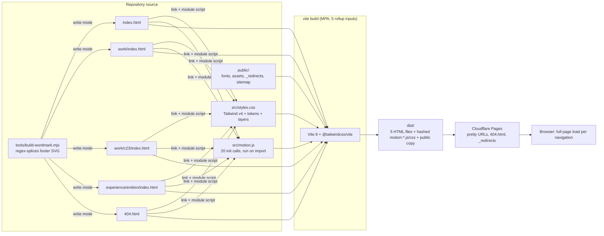
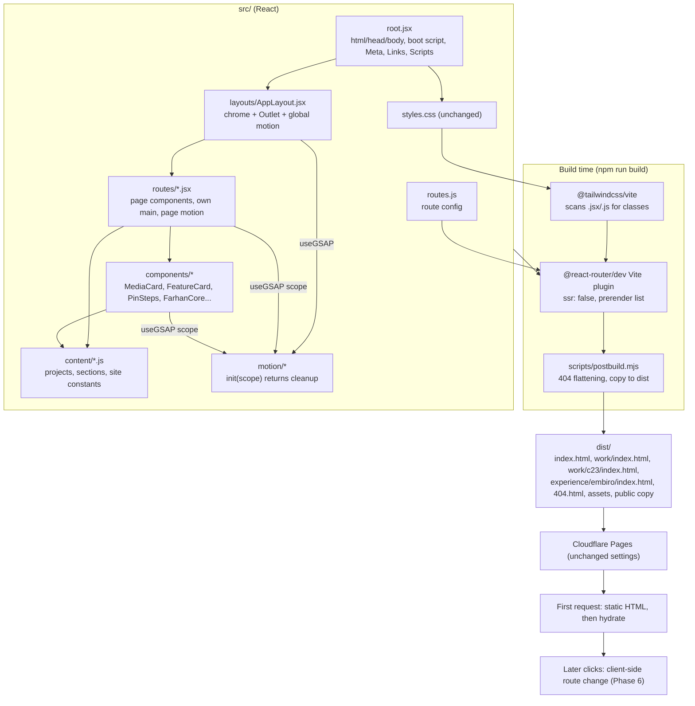
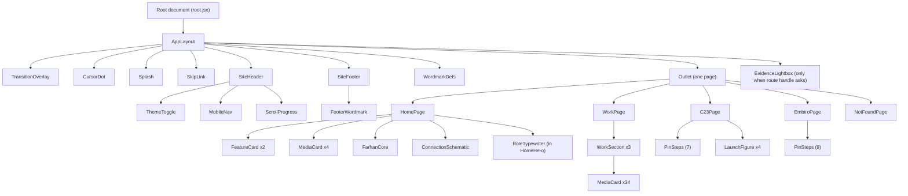
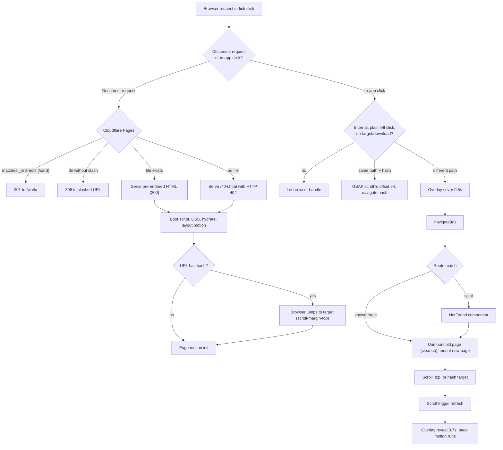
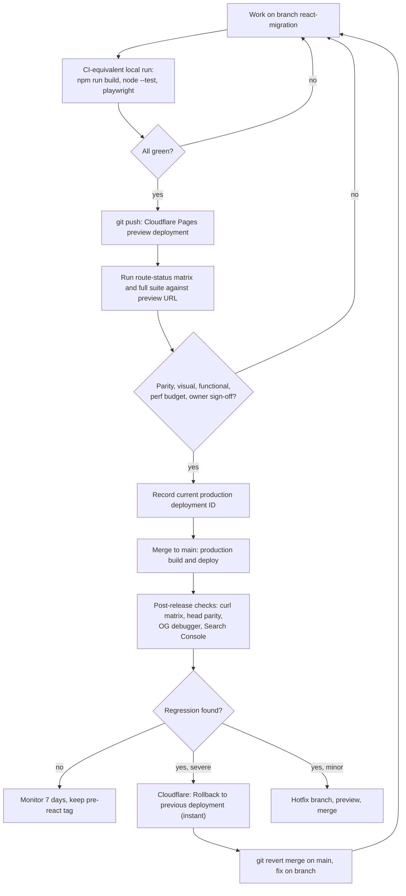
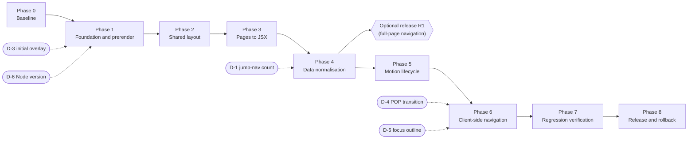
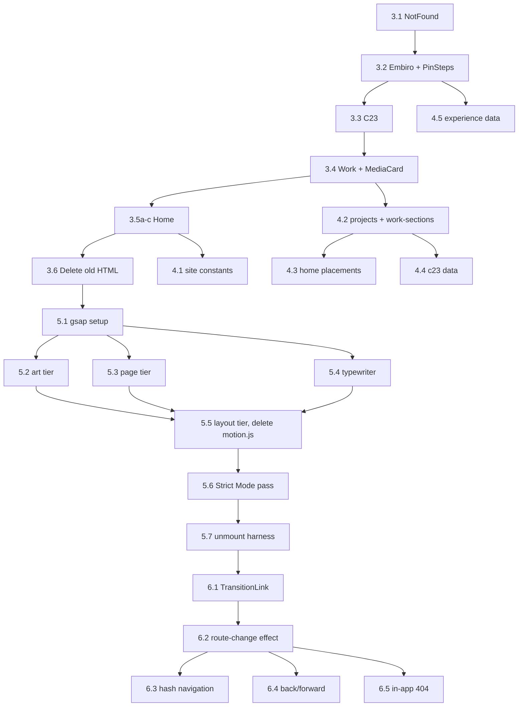

# React Migration Plan: farhansegujja.com

> **Status:** Planning document. Nothing in this document has been implemented yet. Nothing here claims visual parity has been achieved.
> **Execution note for agents:** Implement phase by phase, using checkbox (`- [ ]`) tracking and the exit criteria in §16. Do **not** start Phase 1 until the owner has approved this document and resolved the decisions marked **[DECISION]** in §24.

| | |
|---|---|
| **Scope** | Migrate the static multi-page portfolio to React + React Router while keeping the visitor-facing site visually and behaviourally the same |
| **Repository** | https://github.com/Al-Farhan-Seg/farhansegujja (local clone, branch `main`, HEAD `2f65ab9`, clean, level with `origin/main`) |
| **Production** | https://farhansegujja.com/ (Cloudflare Pages) |
| **Audit date** | 2026-11-12 |
| **Author role** | Migration planning (architecture, React, GSAP, UI preservation, QA, documentation) |

**How to read the evidence labels used throughout**

| Label | Meaning |
|---|---|
| **Confirmed** | Read in the repository source or observed on production during this audit |
| **Proposed** | Recommended future architecture; not built |
| **Verify** | A claim that must be checked (usually in the Phase 1 spike) before it is relied on |
| **Conceptual** | An illustrative code example, not copied from or written into the repository |

**Method and skills used.** The audit followed three skill methodologies, applied as described below rather than run wholesale:

- **superpowers: writing-plans.** Applied for the structure of the plan: a file map before tasks, tasks small enough for independent review, exact verification commands, a "Review focus" list (§17.6) and a self-review against the brief (§26). `superpowers:brainstorming` was not run interactively, because the brief already fixed requirements and forbade implementation. Questions that would normally be brainstormed are listed in §24 instead.
- **impeccable.** Ran `impeccable context`. The project has no PRODUCT.md or DESIGN.md, so the shipped code and assets are the design authority. Ran the mechanical `impeccable detect` over all five pages and `styles.css` (results in §5.6). I used the `audit` lens only to record what exists and must be preserved. I did not use its "fix" recommendations, because this migration is not a redesign.
- **frontend-design.** Its analysis lens (tokens, type roles, layout system, signature elements) produced §11.1. Its generative half ("choose a distinctive new direction") was deliberately **not** applied, because the existing site is the design specification.

---

## Table of contents

1. [Title, scope, references](#react-migration-plan-farhansegujjacom) (above)
2. [Executive summary](#2-executive-summary)
3. [Objectives and non-goals](#3-objectives-and-non-goals)
4. [Preservation requirements and success criteria](#4-preservation-requirements-and-success-criteria)
5. [Current-state architecture audit](#5-current-state-architecture-audit)
6. [Page-by-page inventory](#6-page-by-page-inventory)
7. [Duplication and component-extraction analysis](#7-duplication-and-component-extraction-analysis)
8. [Proposed React architecture](#8-proposed-react-architecture)
9. [React Router strategy](#9-react-router-strategy)
10. [Content and data-model design](#10-content-and-data-model-design)
11. [CSS and design-preservation approach](#11-css-and-design-preservation-approach)
12. [GSAP migration analysis](#12-gsap-migration-analysis)
13. [Proposed file and folder structure](#13-proposed-file-and-folder-structure)
14. [Current-to-target file mapping](#14-current-to-target-file-mapping)
15. [Architecture decision records](#15-architecture-decision-records)
16. [Step-by-step migration phases](#16-step-by-step-migration-phases)
17. [Visual and functional testing strategy](#17-visual-and-functional-testing-strategy)
18. [Performance, accessibility, and SEO](#18-performance-accessibility-and-seo)
19. [Deployment and rollback strategy](#19-deployment-and-rollback-strategy)
20. [Risk register](#20-risk-register)
21. [Task dependency diagrams](#21-task-dependency-diagrams)
22. [Definition of Done](#22-definition-of-done)
23. [Learning guide and prerequisite concepts](#23-learning-guide-and-prerequisite-concepts)
24. [Open questions, assumptions, unresolved decisions](#24-open-questions-assumptions-unresolved-decisions)
25. [Recommended implementation order](#25-recommended-implementation-order)
26. [Implementation-readiness checklist](#26-implementation-readiness-checklist)

---

## 2. Executive summary

**What exists today (Confirmed).** The site is five hand-written HTML documents built by Vite 8 as a multi-page app. Tailwind CSS v4 and one shared stylesheet (`src/styles.css`, 1,458 lines) style it. One 1,772-line GSAP module (`src/motion.js`) animates it. That module runs once per full page load and discovers its targets with `document.querySelector` against `data-*` attributes and classes. Header, footer, overlays, theme toggle and the generated footer wordmark are copied verbatim into all five pages. Portfolio content (34 project cards on `/work/`, several repeated on `/` and `/work/c23/`) is hand-written markup.

**Recommendation (Proposed).**

1. **Use React Router v8 in framework mode with `ssr: false` and build-time pre-rendering of every route** (§15 ADR-01). Each URL keeps a real, fully populated static HTML file, so SEO, Open Graph link previews, direct loads, refreshes and Cloudflare's 404 behaviour stay as they are today. There is no server runtime and the site stays on Cloudflare Pages.
2. **Migrate in a "same DOM first, SPA last" order** (§16). React first reproduces the existing DOM **byte-for-byte equivalently** while internal links remain ordinary full-page loads. In that mode the existing `motion.js` keeps working almost unchanged. Only after pages, layout and data are componentised and proven DOM-identical do we refactor the animations for React's lifecycle. The last step switches on client-side navigation.
3. **Keep `styles.css` nearly verbatim** and treat class names, `data-*` attributes and DOM nesting as a contract (§11). Automated **DOM parity checks** enforce that contract: a normalised comparison of the old and new prerendered HTML (§17.2). They are a stronger guarantee than screenshots alone.
4. **Split GSAP ownership three ways** (§12, ADR-06):
   - **Layout-level, persistent** systems: cursor, header state, progress bar, page transition, theme, mobile nav, splash and footer wordmark.
   - **Page-level, declarative** systems driven by `data-*` attributes: reveals, pins, hero, magnetic, cursor labels, lightbox and FAQ.
   - **Component-owned bespoke visualisations**: Farhan Core, Connection Schematic and the typewriter.

   All three use `useGSAP()` with explicit cleanup.
5. **Move content into plain local JS modules** (`src/content/`), with one record per project and per-placement presentation lists (§10). There is no CMS and no state library.

**Most significant risk.** GSAP lifecycle regressions once navigation becomes client-side (§20, R-01). Today every navigation is a full reload, which hides the module's lack of cleanup: intervals are never cleared, global listeners are never removed, `SplitText` is never reverted, and the splash node is removed imperatively. The plan isolates this risk into Phases 5–6, which come after everything else is proven. Phase 4 is therefore a safe production release point even if client-side navigation is postponed.

**Decisions needing the owner** (details in §24): whether the `/work/` hero should show the derived count "21" or the current hard-coded "22", JS vs TypeScript, keeping the initial-load page-transition sweep, whether to release after Phase 4, and how Cloudflare's build output directory is configured today.

---

## 3. Objectives and non-goals

### 3.1 Objectives

| # | Objective | Measured by |
|---|---|---|
| O1 | Replace five duplicated HTML documents with one shared layout plus page components | Header/footer/overlay markup exists in exactly one source file each |
| O2 | Route all public URLs through React Router | Route config lists every URL in §9.1; prerender emits each |
| O3 | Drive repeated portfolio content from structured data | Each project's URL/image/alt/label is defined once in `src/content/` |
| O4 | Give every animation an owner and a cleanup | Every GSAP/listener/timer site in §12 has a named owner and passes the unmount test (§17.4) |
| O5 | Keep the site visually and behaviourally identical | DOM parity, screenshot, and functional suites in §17 pass |
| O6 | Keep static hosting, SEO and status codes | §18.3 SEO matrix and §19 route-status matrix pass on preview and production |
| O7 | Make the codebase easier to change | A new project card is added by editing one data file (§10.6) |

### 3.2 Non-goals

- **No visual redesign.** That includes typography, palette, spacing, components, animation choreography and copy.
- **No fixes to pre-existing design or accessibility findings** (§5.6) inside the migration. They are logged as follow-ups, to be fixed in separate commits **after** parity is proven, so that a regression is never confused with an intentional change.
- No CMS, backend, server rendering at request time, Redux/Zustand, component library, CSS-in-JS, or CSS-modules rewrite.
- No change to the domain, Cloudflare account structure, DNS, or the subdomain sites.
- No new routes or pages.
- No TypeScript conversion inside the migration, unless the owner chooses it (§24 D-2).

---

## 4. Preservation requirements and success criteria

These requirements restate the brief as testable contracts. Each row names the evidence that proves it.

| Area | Contract | Evidence of success |
|---|---|---|
| Visual identity | Tokens, fonts, sizes, spacing, patterns, radii, shadows, gradients, crops, hover/focus states unchanged | Screenshot suite (§17.3) at 390/768/1440 × light/dark/umber shows no unexplained diff |
| DOM contract | Same elements, classes, `data-*`, ids, nesting and text inside `<body>` | DOM parity script (§17.2) reports zero differences, apart from the documented allow-list (§17.2.3) |
| Motion | Every behaviour in §12.1 is observably the same, including reduced-motion and pointer/touch variants | Functional suite (§17.4) plus a side-by-side video review checklist (§17.5) |
| Content | Every string, link, image, alt text and ordering is the same | DOM parity (text and attributes) and a link crawler (§17.4 F-02) |
| URLs | `/`, `/work/`, `/work/c23/`, `/experience/embiro/`, `/card` → `/work/` 301, unknown → 404 page with HTTP 404, no-slash → 308 to slash | Route-status matrix (§19.3) run with `curl` against preview and production |
| SEO | Per-page `<title>`, description, canonical, OG/Twitter tags, JSON-LD on `/`, `noindex` on 404, sitemap and robots unchanged | Head parity check (§17.2.4) |
| Themes | Light/dark/umber cycle, persistence, no flash on load, `theme-color` meta synced | F-07, F-08 (§17.4) |
| Performance | No material regression versus the baseline | Lighthouse budget (§18.1) |

**Global constraints (apply to every task).**

- Do not edit visible copy, URLs, alt text, or ordering.
- Do not rename CSS classes, ids or `data-*` attributes.
- Do not construct Tailwind class names dynamically, such as `` `lg:col-span-${n}` ``. Every class must appear as a complete literal string somewhere in source (§11.4).
- Node ≥ 22.22 (required by `@react-router/dev` 8.5.1, **Confirmed** via `npm view`).
- Every commit must pass the repository's `commit-msg` hook. The hook rejects AI attribution lines.

---

## 5. Current-state architecture audit

### 5.1 File inventory (Confirmed)

The repository has 65 tracked files. The significant ones:

| File | Lines | Responsibility |
|---|---:|---|
| `index.html` | 999 | Home. Inline boot script, SEO and JSON-LD, all home sections, inline Farhan Core and Connection Schematic SVGs, wordmark defs and footer |
| `work/index.html` | 670 | `/work/` portfolio: hero cards, 3 sections, 34 cards |
| `work/c23/index.html` | 541 | C23 case study: pinned 7-day steps, deployment list, launch figures, lightbox `<dialog>` |
| `experience/embiro/index.html` | 435 | Embiro role page with 9 pinned progression steps |
| `404.html` | 348 | Not-found page, `noindex` |
| `src/styles.css` | 1,458 | Tailwind import, `@font-face`, `@theme` tokens, theme overrides, `@layer base`, a custom `@layer motion` (pre-animation hidden states), `@layer components` |
| `src/motion.js` | 1,772 | All JS behaviour: 20 init calls run at import time (§12) |
| `vite.config.js` | 20 | Tailwind plugin plus 5 Rollup HTML inputs |
| `package.json` | 24 | `vite`, `tailwindcss`, `@tailwindcss/vite`, `gsap`; also `lucide-static` and `simple-icons`, which no build file imports (§5.5 I-08) |
| `tools/build-wordmark.mjs` | 587 | Generates the footer wordmark SVG from a parametric glyph system and **regex-splices it into all 5 HTML files** (`--write`, lines 543–565) |
| `public/_redirects` | 1 | `/card /work/ 301` |
| `public/sitemap.xml` | — | 4 URLs. References an external XSL stylesheet from xml-sitemaps.com |
| `public/robots.txt` | — | Allow all, sitemap link |
| `public/fonts/*.woff2` | — | Nunito (variable 400–600), Revalia, Sour Gummy (self-hosted) |
| `public/assets/**` | — | 40 WebP/PNG screenshots and portrait renditions |
| `.githooks/commit-msg` | — | Rejects AI attribution in commit messages |
| `.nvmrc` | — | `22` |

### 5.2 How a page works today (Confirmed)

The following sequence runs on every page load:

1. **Inline boot script** in `<head>` (for example `index.html:8-31`). It runs before CSS:
   - adds `js`
   - adds `motion-reduced` if `prefers-reduced-motion: reduce` matches
   - applies the stored theme (`localStorage.theme`) to `<html data-theme>`
   - sets `<meta name="theme-color">` from a hard-coded map
   - adds `splash-seen` if `sessionStorage.splashSeen === '1'`
2. **CSS** (`/src/styles.css`, linked in `<head>`):
   - The `@layer motion` rules hide animatable elements **only** under `.js:not(.motion-reduced)`. Without JS, or with reduced motion, every element is visible and complete. This progressive-enhancement contract must survive.
3. **`motion.js`** (module script at the end of `<body>`):
   - registers ScrollTrigger, ScrollToPlugin and SplitText
   - reads `reduced` and `finePointer` **once** at load
   - runs every `init*()` function (20 calls, `motion.js:12-36`)
   - each init is a no-op when its selector finds nothing; that is how one module serves all five pages
4. **Navigation** (`initPageTransitions`, `motion.js:79-126`):
   - internal links play a 0.5 s cover animation, then set `location.href`, which triggers a full document load
   - the new document's script immediately sets the overlay to cover and reveals it over 0.7 s



### 5.3 Production versus repository (Confirmed, 2026-11-12)

| Check | Result |
|---|---|
| Live HTML vs HEAD content | Matches. `/work/` has 34 cards including Uhuru Institute (latest commit); `/` lists Python and Django |
| Live asset names | `/assets/motion-K3Kjnyb4.js`, `/assets/motion-BL19h0-a.css` (one shared bundle) |
| `/work`, `/work/c23`, `/experience/embiro` | **308** → trailing-slash URL (Cloudflare Pages "pretty URLs") |
| `/index.html`, `/work/index.html` | **308** → directory URL |
| `/404.html` | 308 → `/404`, which then returns 404 |
| `/card` | **301** → `/work/` (`_redirects`) |
| `/card/`, `/sales-role/`, `/experience/`, unknown paths | **404** with the custom 404 page |
| Splash | Plays on **whichever page starts the browser session**: a direct `/work/` visit showed the splash. This contradicts the comment in `styles.css:253` ("homepage only") |
| `/sales-role/` | Removed in commit `550b520`; correctly 404s. No redirect exists. Inbound links, if any, also 404 today |

**Not verifiable from the repository (Verify).** The Cloudflare Pages dashboard settings: build command, output directory (assumed `dist`), Node version source, preview-branch settings, and any dashboard-level redirects or headers. There is no `wrangler.toml` in the repository, so the project is assumed to be Git-integrated and dashboard-configured.

### 5.4 Design language and dependencies

See §11.1 for the design-language analysis. Runtime dependency: `gsap@^3.15.0` (lockfile 3.15.0; latest 3.15.1). Build: `vite` 8.2.2 (lockfile), `tailwindcss` / `@tailwindcss/vite` 4.3.3.

### 5.5 Latent issues discovered (Confirmed unless marked)

These are recorded so the migration neither breaks them unknowingly nor "fixes" them silently.

| ID | Finding | Evidence | Migration stance |
|---|---|---|---|
| I-01 | Typewriter uses `setInterval`/`setTimeout` chains with no cancellation | `motion.js:427-465` | Must gain cleanup in Phase 5. Harmless only because of full reloads |
| I-02 | Global listeners are never removed: cursor (`window`), mobile nav (`document`), magnetic/hover per element | `motion.js:162-182, 551-608` | Layout-level ones live forever, which is acceptable. Page-level ones need cleanup |
| I-03 | Splash removes a DOM node imperatively (`splash.remove()`) | `motion.js:257-261` | Incompatible with React ownership. Replace with state-driven unmount (Phase 5) |
| I-04 | `SplitText` on the hero `<h1>` is never reverted | `motion.js:353` | Must revert on unmount (`useGSAP` context does this) |
| I-05 | `/work/` hero chip says **"Subdomain Work · 22"**, but the section has **21** cards. Custom (8) and C23 (5) are correct | `work/index.html:137`; card count | **[DECISION D-1]** |
| I-06 | Stale comments: `motion.js:481` says "5/5/21-card sections" (actual 8/5/21); `styles.css:253` says splash is homepage-only (it is on all pages) | source | Fix comments when the code moves (no behavioural change) |
| I-07 | `public/assets/next-media/next-media-mobile.webp` is not referenced anywhere | grep across pages and src | Keep (a public file may have inbound links). Flag for owner |
| I-08 | `lucide-static` and `simple-icons` are devDependencies, but no build file imports them. The icon SVGs were copied into the HTML | grep | Keep during migration; decide afterwards (§24 D-8) |
| I-09 | C23 "Launches" external links (`work/c23/index.html:240-278`) lack `target="_blank"`. Every other external project link has it | source | Preserve as-is (content contract); flag (§24 D-9) |
| I-10 | Home progression list and Embiro pin steps duplicate the same 9 items with slightly different text. Example: "Direct React / Vite / Tailwind development" vs "Direct React/Vite/Tailwind development:" | `index.html:263-271`, `experience/embiro/index.html:145-180` | Store both forms in data. Do not normalise (§24 D-10) |
| I-11 | `package.json` `engines.node` is `>=20`; React Router 8.5.1 needs `>=22.22.0` | `npm view @react-router/dev engines` | Update in Phase 1 |
| I-12 | `reduced` and `finePointer` are captured once at load. Only the wordmark, schematic and Farhan Core react live to media changes via `gsap.matchMedia` | `motion.js:9-10, 657, 1052, 1275` | Preserve this hybrid exactly (§12.4) |
| I-13 | Back/forward through the browser's back-forward cache (bfcache) may restore a page whose overlay was left covering it: the cover animation ran before `location.href`, and there is no `pageshow` handler | Code reading only | **Verify in Phase 0** (F-05b). If reproducible, the SPA navigation removes this failure mode by construction |
| I-14 | Two different anchor offsets: GSAP same-page scroll uses `offsetY: 64`; native cross-page jumps use CSS `scroll-margin-top: 5rem` (90 px at the 112.5 % root size) | `motion.js:72`, `styles.css:165-168` | Preserve both: same-page = 64 px, cross-page = 5 rem |

### 5.6 Impeccable detector results (Confirmed run; findings triaged, not fixed)

`impeccable detect` returned 22 findings across the five pages:

| Finding | Where | Triage |
|---|---|---|
| Low contrast 2.4:1 (`#a09e97` on paper); 4.4:1 (`#75726d`); hover 1.9:1 (ink on `signal-strong`) | `/`, `/work/` | **Verify in browser.** These are likely the `text-signal/70` step numbers and an outline-CTA hover state. Pre-existing; log as an a11y follow-up after parity (§24 D-11) |
| Cramped padding ×8 on `.faq-item` | `/` | Detector false positive. The FAQ is an intentional ruled list with no box |
| Flat type hierarchy | all pages | False positive. The static analysis cannot resolve Tailwind utilities (`h-display`, `h-section`) |
| Cream palette | all pages | Intentional identity (paper `#f7f4ec`). Preserve |
| `` with no `src` | `/work/c23/` lightbox | Intentional. Populated at runtime, cleared on close |

**Implementation-integrity verdict (impeccable lens): Pass.** The codebase expresses a coherent, product-specific system:

- a shared technical-drawing vocabulary (crosshairs, ticks, datum rules) across the wordmark, Connection Schematic and Farhan Core
- tokens consumed everywhere through CSS variables, so all three themes re-skin without per-theme assets
- documented progressive enhancement

That coherence is exactly what the migration must not erode.

---

## 6. Page-by-page inventory

All pages share the **chrome**, in this exact DOM order inside `<body>`:

1. `.page-transition`
2. `.cursor-dot`
3. `.splash-screen[data-splash]` (with particles layer and logo ``)
4. `.skip-link` → `#main`
5. `header.site-header`: logo link, desktop `nav`, theme toggle (3 icons + CSS-generated label), `details.nav-mobile` drawer, `.scroll-progress`
6. **page `<main id="main">`** (attributes differ per page)
7. a hidden `<svg>` holding wordmark glyph `<defs>` (`#wm-F`, `#wm-A`, …)
8. `footer.site-footer` (`.footer-dissolve` plus desktop and mobile wordmark SVGs)
9. page-specific trailing elements (only `/work/c23/`: `dialog#evidence-lightbox`)
10. `<script type="module" src="/src/motion.js">`

Header nav hrefs differ only on `/`, which uses `#experience`, `#about` and `#contact`. Every other page uses `/#experience` and so on (diff confirmed). The footer is byte-identical on all five pages.

### 6.1 `/` (index.html)

| # | Section (id) | Unique components | Interactive / motion dependencies | Notes |
|---|---|---|---|---|
| 1 | Hero (`[data-hero]`, `.hero-section`) | Greeting + Revalia name `h1`, typewriter role, CTAs, engraved portrait `<picture>` (srcset 640/960/1312 webp + PNG fallback, `fetchpriority="high"`) | Hero intro timeline + SplitText (M09), typewriter (M11), magnetic `.btn` (M14), CSS cursor blink | `min-height: 100svh`; `sr-only` full role list for screen readers |
| 2 | `#work` Selected Work | 2 **feature cards** (`article.bento-card--media`, col-span 7/5) with caption, paragraph, tag list, CTA | Reveal group (M12), cursor labels `View`/`Visit` (M15), image hover zoom (M16) | C23 card links internally to `/work/c23/` |
| 3 | `#experience` | Role dates, intro, numbered list `01–09`, CTA to `/experience/embiro/` | Reveals | Same 9 items as Embiro pin steps (I-10) |
| 4 | `#shipping` (#SheBuilds) | 4 media cards (spans 7/5/5/7), CTA to `/work/` | Reveal group, cursor, hover zoom | Same 4 projects appear in `/work/` custom-domain section |
| 5 | `#technical` | Traffic Sign Recognition copy + `.evidence-frame` image | Reveals, hover zoom | External demo and GitHub buttons |
| 6 | `#capabilities` | 5 bento cards with 29 `.tag` items, each with an inline brand/lucide SVG icon | Reveal group | Icons copied from simple-icons/lucide (I-08) |
| 7 | `#about` (`.about-section`) | Statement, **Farhan Core** SVG (480×520, 4 nodes, deformable paths, depth layers), triptych | Farhan Core entrance, ambient, proximity/taps, parallax (M22–M25) | `aria-hidden` art |
| 8 | `#contact` (`.contact-hero`, `data-reveal` on section) | Veil, Revalia heading, CTA, **Connection Schematic** SVG (5 nodes), info rail | Schematic proximity/taps (M21) | `md+`: full-viewport composition |
| 9 | `#faq` | 8 `details.faq-item[data-faq]` | FAQ accordion (M26) | Last item contains a WhatsApp link that must stay clickable |
| — | `<head>` | JSON-LD `Person`, OG `website` | — | Only page with JSON-LD |

### 6.2 `/work/`

| # | Section | Components | Motion |
|---|---|---|---|
| 1 | Hero (`[data-hero]`, `.work-hero-grid`) | Copy card (kicker, `h1` "Work", paragraph with external link, jump-nav of 3 `.work-cta` pills with counts), signal card with rocket SVG | Work hero slide-in with braking shudder (M10), hero intro (kicker/copy/actions; SplitText on one-word `h1`), cursor label `Jump` |
| 2 | `#embiro-custom-domain` | Intro with Embiro link, **8** media cards (`lg:col-span-4`) | `ScrollTrigger.batch` reveal (`data-reveal-batch`) |
| 3 | `#c23` | **5** media cards, caption is the hostname in mono | batch reveal |
| 4 | `#embiro-subdomain` | Same intro as section 2, **21** media cards | batch reveal |

The jump-nav anchors (`#embiro-custom-domain` and so on) are same-page smooth-scroll links (M04).

### 6.3 `/work/c23/`

Sections:

1. Header with status `dl`
2. Lead evidence `figure.evidence-frame[data-enlarge]` (cursor `Enlarge`)
3. "What it is"
4. **Pinned seven-day build**: `.pin-steps[data-pin-steps]` with 7 `[data-step]`
5. Deployment list of 5 hostnames with launch dates (`data-reveal-group`)
6. Launches: 4 figures with external links (I-09)
7. Limitations + GitHub link

After the footer comes `dialog#evidence-lightbox`. Motion: reveals, pin steps (M13), lightbox (M17), hover zoom, cursor labels. `og:type` is `article`.

### 6.4 `/experience/embiro/`

Sections:

1. Header with role dates and intro (same text as home `#experience`)
2. Pinned 9-step progression (`01 / 09` … `09 / 09`)
3. "Where this shows up", with a cross-page anchor link to `/#shipping`

Motion: reveals, pin steps. No cursor labels or magnetic buttons on this page.

### 6.5 `404.html`

The `<main>` itself carries `class="container-page py-20 lg:py-28" data-reveal`. That is one reason `<main>` must be rendered by page components, not by the layout. Content: kicker "404", `h1.h-section`, a short paragraph, and a `.btn` back to `/`. Head: `noindex`, and no canonical or OG tags.

### 6.6 Page → component mapping

| Page | Page component | Composed of |
|---|---|---|
| `/` | `routes/home.jsx` | `HomeHero`, `SelectedWork` (`FeatureCard`×2), `ExperienceSummary`, `SheBuilds` (`MediaCard`×4), `TechnicalProject`, `Capabilities` (`TechTag`), `AboutSection` (`FarhanCore`), `ContactSection` (`ConnectionSchematic`), `Faq` |
| `/work/` | `routes/work.jsx` | `WorkHero` (jump-nav derived from `workSections`), `WorkSection`×3 (`MediaCard`) |
| `/work/c23/` | `routes/work-c23.jsx` | `CaseHeader`, `EvidenceFigure`, `PinSteps`, `DeploymentList`, `LaunchFigure`×4, `handle.lightbox` → `EvidenceLightbox` in layout |
| `/experience/embiro/` | `routes/experience-embiro.jsx` | `RoleHeader`, `PinSteps`, prose section |
| 404 | `routes/not-found.jsx` | Inline markup (small; no abstraction) |
| all | `layouts/AppLayout.jsx` | `TransitionOverlay`, `CursorDot`, `Splash`, `SkipLink`, `SiteHeader` (`ThemeToggle`, `MobileNav`), `<Outlet/>`, `WordmarkDefs`, `SiteFooter` (`FooterWordmark`), optional `EvidenceLightbox` |

---

## 7. Duplication and component-extraction analysis

The rule applied: **extract only when two copies share responsibility and behaviour, not merely appearance** (premature abstraction is a regression risk of its own).

| Duplication (Confirmed) | Copies | Becomes | Why |
|---|---|---|---|
| `<head>` boot script, font preloads, favicons, theme-color | 5 | `root.jsx` document + `links()` | One document shell in framework mode |
| Per-page title/description/canonical/OG/Twitter | 5 (different values) | Each route's `meta()` export + `lib/seo.js` helper | Values differ per route; structure is the same |
| Overlays (transition, cursor, splash) + skip link | 5 identical | Layout components | Global, persistent across routes |
| Header (desktop nav, theme toggle, mobile drawer) | 5 (only hrefs differ) | `SiteHeader` + `sectionHref(id, isHome)` | Preserves `#about` vs `/#about` exactly |
| Footer + wordmark defs | 5 identical, generated | `SiteFooter` with generated markup injected (§11.5) | Generator output must not be hand-converted |
| Media card (`a.bento-card.bento-card--media`) | 4 on `/`, 34 on `/work/` | `MediaCard` + data | Same markup, same behaviour (cursor `Visit`, hover zoom, reveal child) |
| Feature card (`article.bento-card--media` with tags and paragraph) | 2 on `/` | `FeatureCard` | Different structure from `MediaCard` (article, inner link, tag list). **Do not merge** |
| C23 launch figure (`figure > a.evidence-frame`) | 4 | `LaunchFigure` | Different from `MediaCard`: different classes and no `target` attribute |
| Pin steps | 2 pages (7 and 9 steps) | `PinSteps` component, page-level motion | Same DOM contract and behaviour |
| Section intro (kicker + `h2.h-section`) | ~12 | **Leave as JSX** | Variants differ in margin classes (`mb-2`/`mb-3`/`mb-4`), wrapper `data-reveal` placement and extra captions. A component would need so many props that it hides the markup it exists to keep |
| Embiro ownership note (paragraph with link) | 2 on `/work/` | `EmbiroOwnershipNote` | Identical rich text including a link, so it stays JSX rather than a data string |
| Contact constants (WhatsApp, phone, email, GitHub) | ≥6 places + JSON-LD | `content/site.js` constants | A single change point for contact details |
| Role dates and intro paragraph | `/` and `/experience/embiro/` | `content/experience.js` | Same text, different wrapper classes |
| Progression items | `/` (short) and Embiro (long) | `content/experience.js` with `short` and `long` fields | Text differs (I-10), so both are stored |
| C23 sites (hostname, URL, image, launch date, description) | `/` tags, `/work/` cards, `/work/c23/` list and figures | `content/c23.js` (projects referencing shared records) | Four contexts, one source |
| Animation configuration | One file already | Split by owner (§12) | Not duplicated today; the split is for lifecycle, not de-duplication |
| Hand-maintained counts "· 8 / · 5 / · 22" | 1 | Derived from data **subject to D-1** | Derivation is the point of the data model, but it changes visible text |

---

## 8. Proposed React architecture

### 8.1 Target architecture



### 8.2 Component hierarchy



### 8.3 Component responsibilities (what each owns and why it exists)

| Component | Owns | Justification |
|---|---|---|
| `root.jsx` (`Layout`, `App`, `ErrorBoundary`) | `<html lang data-theme="light" suppressHydrationWarning>`, boot script, static head tags, `<Meta/>`, `<Links/>`, `<Scripts/>` | Framework-mode document; replaces five `<head>`s |
| `AppLayout` | Chrome order (§6), global motion init, page-transition controller, route-change effects (scroll, focus, ScrollTrigger refresh) | The only component that lives across navigations |
| `SiteHeader` | Header markup; `.is-scrolled` is toggled imperatively by ScrollTrigger | Identical across pages except hrefs |
| `ThemeToggle` | Click cycles `data-theme` on `<html>`, `localStorage`, meta sync. **No React state**: label and icons stay CSS-driven | Keeps the "nothing to flicker" design (`styles.css:734-763`) |
| `MobileNav` | Native `<details>`; enhancements (close on link, outside click, Esc) | Zero-JS baseline preserved |
| `Splash` | Particles timeline; **unmounts itself via state** instead of `splash.remove()` | I-03 |
| `CursorDot` | `quickTo` follower; label expansion via **event delegation** on `[data-cursor]` | Labels must work for elements on any page without re-binding |
| `TransitionOverlay` + `usePageTransition()` | Cover then `navigate()`, reveal on new location | §12.5 |
| `SiteFooter` / `FooterWordmark` / `WordmarkDefs` | Generated SVG (injected), entrance replay per route, ink interactions | §12.6 special case |
| `MediaCard` | One card's markup | 38 instances |
| `FeatureCard` | Rich card (article + tags + CTA) | 2 instances, distinct structure |
| `PinSteps` | `.pin-steps` markup from a step list | 2 instances; motion stays attribute-driven |
| `FarhanCore`, `ConnectionSchematic` | Injected SVG plus their own `useGSAP` blocks | Bespoke, self-contained systems |
| `RoleTypewriter` | Text span plus timers with cleanup | I-01 |
| `EvidenceLightbox` | `<dialog>` and open/close wiring | Rendered after the footer to keep DOM order |
| `TransitionLink` | Internal link that participates in the page transition | Single place for link policy (§9.4) |

There is no global state store. The only cross-component state is the transition controller, provided by `AppLayout` via a small React context. Theme lives on `<html>`, not in React.

---

## 9. React Router strategy

### 9.1 Route table (Proposed)

| URL | Route id | Module | Prerendered file | HTTP status (Cloudflare) |
|---|---|---|---|---|
| `/` | `home` | `routes/home.jsx` | `index.html` | 200 |
| `/work/` | `work` | `routes/work.jsx` | `work/index.html` | 200 (`/work` → 308) |
| `/work/c23/` | `work-c23` | `routes/work-c23.jsx` | `work/c23/index.html` | 200 (no slash → 308) |
| `/experience/embiro/` | `experience-embiro` | `routes/experience-embiro.jsx` | `experience/embiro/index.html` | 200 (no slash → 308) |
| *(build only)* `/404` | `not-found-static` | `routes/not-found.jsx` | `404/index.html` → **moved to `404.html`** by postbuild | 404 for any unmatched path |
| `*` (client) | `not-found` | `routes/not-found.jsx` | — | Renders client-side only after an in-app navigation to an unknown path |
| `/card` | — | `public/_redirects` | — | 301 → `/work/` (unchanged) |

### 9.2 Route configuration (Conceptual, derived from the URL set above)

```js
// src/routes.js — Conceptual
import { index, layout, route } from '@react-router/dev/routes'

export default [
  layout('layouts/AppLayout.jsx', [
    index('routes/home.jsx'),
    route('work', 'routes/work.jsx'),
    route('work/c23', 'routes/work-c23.jsx'),
    route('experience/embiro', 'routes/experience-embiro.jsx'),
    // Pre-rendered once so postbuild can publish it as /404.html
    route('404', 'routes/not-found.jsx', { id: 'not-found-static' }),
    // Client-side catch-all for in-app links to unknown paths
    route('*', 'routes/not-found.jsx', { id: 'not-found' }),
  ]),
]
```

```js
// react-router.config.js — Conceptual
export default {
  appDirectory: 'src',       // keep styles.css and motion code where they are
  ssr: false,                // no runtime server: static hosting only
  prerender: ['/', '/work', '/work/c23', '/experience/embiro', '/404'],
}
```

**Verify in the Phase 1 spike:**

- (a) the exact output paths for `/work` (docs show `/blog` → `blog/index.html`)
- (b) that `/404` prerenders with status 200, because it is an explicit route, not the splat
- (c) that `__spa-fallback.html` is emitted, because `/` is prerendered. It is deleted by postbuild (ADR-09)
- (d) whether `.data` files are emitted when no route has a `loader`

### 9.3 Trailing slashes

React Router matching ignores a trailing slash, so `/work` and `/work/` both match `route('work')`. The canonical form stays the slashed URL:

- Internal links are written exactly as today (`/work/`, `/work/c23/`, `/experience/embiro/`), so rendered `href` values stay byte-identical (DOM parity) and the address bar after client navigation shows the slashed URL.
- Direct requests to the non-slash form are 308-redirected by Cloudflare, exactly as today, because the files are `dir/index.html`.
- `<link rel="canonical">` values are static strings in each route's `meta()` and keep their slashes.

### 9.4 Navigation behaviour matrix (Proposed, Phase 6 onward)

| Scenario | Today (Confirmed) | After migration (Proposed) |
|---|---|---|
| **Initial load / refresh of any URL** | Static HTML, boot script, CSS, `motion.js`; overlay snaps to cover and reveals over 0.7 s; splash if first page in session | Static prerendered HTML, same boot script and CSS; React hydrates; layout motion runs; overlay reveal per **D-3**; splash identical |
| **Internal link click** (`/work/` from `/`) | Cover 0.5 s → full load → reveal 0.7 s; scroll at top | `TransitionLink`: cover 0.5 s → `navigate('/work/')` → old page cleanup → new page mount → `window.scrollTo(0,0)` → page motion init → `ScrollTrigger.refresh()` → reveal 0.7 s |
| **Modifier/middle click, `target=_blank`, `download`, `mailto:`, `tel:`, external** | Not intercepted | Not intercepted (same predicate, `motion.js:102-113`, moved to `lib/links.js`) |
| **Same-page hash** (`#about` on `/`, jump-nav on `/work/`) | GSAP `scrollTo` 0.9 s `power3.inOut`, `offsetY: 64`, `history.pushState` | Same tween; history updated via `navigate({ hash }, { preventScrollReset: true, replace: false })` so the router's location stays truthful |
| **Cross-page hash** (`/#about` from `/work/`, `/#shipping` from Embiro) | Transition cover → full load → browser native jump honouring `scroll-margin-top: 5rem` → reveal | Cover → navigate → after mount and one `ScrollTrigger.refresh()`, `target.scrollIntoView()` (instant, honours the same `scroll-margin-top`) behind the overlay → reveal |
| **Back / forward** | Full load or bfcache restore (I-13); browser restores scroll | React Router `<ScrollRestoration/>` restores the saved position; page motion re-inits; triggers above the viewport fire immediately (GSAP plays tweens whose start is already passed). **No cover** animation on POP (D-4) |
| **Unknown internal path** | Full load → 404 page (HTTP 404) | In-app: splat route renders the same 404 component. Direct request: Cloudflare serves `/404.html` with HTTP 404 |
| **`/card`** | 301 → `/work/` | Unchanged (Cloudflare `_redirects`, never reaches React) |

### 9.5 Routing flowchart



### 9.6 Accessibility of route changes

A full page load resets focus to the document and the screen reader announces the new title. Client-side navigation does neither by default. Proposed (Phase 6):

- After each PUSH navigation without a hash, move focus to the page's `<main id="main">` (`tabIndex={-1}`, `focus({ preventScroll: true })`). With a hash, focus the target.
- The title updates through `meta()`. Screen readers announce the focused landmark.
- **Visual risk:** a programmatically focused `<main>` could show the `:focus-visible` outline after keyboard navigation. **Verify in Phase 6.** If it appears, add `main[tabindex="-1"]:focus { outline: none; }`. This is a one-line, non-visual-change addition; see D-5.

---

## 10. Content and data-model design

### 10.1 Principles

- **Plain ES modules** in `src/content/`, imported statically. No loaders and no fetch. The data is bundled and prerendered.
- **One record per real-world thing** (a project site, a C23 participant, a role). **Placements** (which page, which order, which grid span) are separate lists that reference records by `id`. That is how one source of truth can still produce page-specific presentation.
- **Only fields the site uses today.** No `featured`, `category` or `tags` taxonomy until a feature needs them (YAGNI).
- **Rich text that contains links stays JSX** (a small component), not HTML strings in data.
- Layout class strings (`lg:col-span-7`) live in placement data as **complete literals** (Tailwind scanning, §11.4).

### 10.2 Model

| Field | Type | Used by | Notes |
|---|---|---|---|
| `id` | string, kebab-case, unique | all placements | Stable key; also React `key` |
| `url` | absolute URL | card `href` | External live site |
| `label` | string | card title | Hostname or brand. **Kept per record as rendered today** (for example `ikorushoneystore.com` vs `Next Media`) |
| `caption` | string | card caption | Exact current text including `·` separators |
| `image.src` / `alt` / `width` / `height` | string / string / number / number | `` | Width and height prevent layout shift and keep ScrollTrigger positions stable |
| `captionStyle` | `'text' \| 'hostname'` | `MediaCard` | `'hostname'` → `caption font-mono text-xs` (C23 cards on `/work/`) |
| `launchDate` | ISO date string | C23 deployment list | C23 records only |
| `launchCaption` | string | C23 launch figure | Different description from `/work/` caption (Confirmed) |

### 10.3 Representative data (Conceptual; values copied from `work/index.html`, `work/c23/index.html`)

```js
// src/content/projects.js — Conceptual
/** @typedef {{ src: string, alt: string, width: number, height: number }} ProjectImage */
/** @typedef {{ id: string, url: string, label: string, caption: string,
 *              captionStyle?: 'text'|'hostname', image: ProjectImage }} Project */

/** @type {Project[]} */
export const projects = [
  {
    id: 'uhuru-institute',
    url: 'https://uhuruinstitute.org',
    label: 'uhuruinstitute.org',
    caption:
      'The Uhuru Institute · Africa-focused cooperative growth partner: media, learning, research, digitalisation and financing',
    image: { src: '/assets/work/custom/uhuruinstitute.webp', alt: 'The Uhuru Institute homepage', width: 1600, height: 1000 },
  },
  {
    id: 'nimu-timber',
    url: 'https://nimu-timber.farhansegujja.com',
    label: 'Nimu Timber & Woodworks',
    caption: 'nimu-timber.farhansegujja.com',
    captionStyle: 'hostname',
    image: { src: '/assets/c23/c23-nimu-timber.webp', alt: 'Nimu Timber & Woodworks website', width: 800, height: 600 },
  },
  // ...one record per site (34 distinct cards on /work/)
]

export const projectById = new Map(projects.map((p) => [p.id, p]))
```

```js
// src/content/work-sections.js — Conceptual (structure from work/index.html:125-447)
export const workSections = [
  {
    id: 'embiro-custom-domain',          // section id = anchor target, unchanged
    kicker: 'Embiro Technologies',
    heading: 'Custom Domain Work',
    headingClass: 'h-section mb-2',
    intro: 'embiro-ownership',           // renders <EmbiroOwnershipNote/>
    jump: { label: 'Custom Domain Work', variant: 'work-cta--solid', countLabel: null },
    projectIds: ['uhuru-institute', 'next-media', 'kin-kariisa', 'ikorus-honey', /* ... */],
  },
  // c23 (5), embiro-subdomain (21; jump.countLabel: '22' until D-1 is decided)
]
```

```js
// src/content/c23.js — Conceptual: one source, four contexts
export const c23Launches = [
  { projectId: 'nimu-timber', name: 'Nimu Timber & Woodworks', launched: '9 Aug 2026',
    launchCaption: 'Timber and woodworks supplier, Uganda' },
  // nutking (16 Aug), modestmuse (23 Aug), wrist-mode (30 Aug)
]
```

### 10.4 Rendering cards from data without changing markup (Conceptual, markup derived from `work/index.html:162-168`)

```jsx
// src/components/work/MediaCard.jsx — Conceptual
export function MediaCard({ project, span = 'lg:col-span-4' }) {
  const { url, label, caption, captionStyle, image } = project
  return (
    <a
      href={url}
      className={`bento-card bento-card--media ${span}`}
      data-cursor="Visit"
      target="_blank"
      rel="noopener noreferrer"
    >
      
      <div className="bento-card-body">
        <span className="font-medium text-ink">{label}</span>
        <span className={captionStyle === 'hostname' ? 'caption font-mono text-xs' : 'caption'}>{caption}</span>
      </div>
    </a>
  )
}
```

```jsx
// src/components/work/WorkSection.jsx — Conceptual
export function WorkSection({ section }) {
  return (
    <section id={section.id} className="rule-top container-page py-12 lg:py-16">
      <div className="mb-8" data-reveal>
        <p className="kicker mb-2">{section.kicker}</p>
        <h2 className={section.headingClass}>{section.heading}</h2>
        {section.intro === 'embiro-ownership' && <EmbiroOwnershipNote />}
      </div>
      <div className="bento-grid" data-reveal-group data-reveal-batch>
        {section.projectIds.map((id) => (
          <MediaCard key={id} project={projectById.get(id)} />
        ))}
      </div>
    </section>
  )
}
```

**Why this keeps the CSS working.** The rendered tree is the same element types, the same class strings in the same order, the same `data-*` attributes and the same parent/child relationships as today. That matters for these contracts:

- `[data-reveal-group] > *` (`styles.css:191`) still targets each `<a>`
- `.bento-card--media img` (`styles.css:656`) still reaches the image
- `motion.js`'s `frame.querySelector('img')` still finds it

The DOM parity check (§17.2) proves this mechanically rather than by inspection.

### 10.5 Separation of presentation and content (Conceptual)

```jsx
// Presentation decides markup and classes; content decides words and URLs.
// SheBuilds on "/" reuses the same records with home-specific spans:
const sheBuilds = [
  { id: 'ikorus-honey', span: 'lg:col-span-7' },
  { id: 'read-us-africa', span: 'lg:col-span-5' },
  { id: 'your-african-neighbour', span: 'lg:col-span-5' },
  { id: 'sapondo', span: 'lg:col-span-7' },
]
// <MediaCard project={projectById.get(id)} span={span} />
```

The same `ikorus-honey` record feeds `/` and `/work/`. Changing its URL or screenshot once updates both pages, and each page still decides its own grid span.

### 10.6 Data integrity tests (Proposed)

Use the built-in `node --test` runner, so no new dependency is needed:

- `id` values are unique
- every `projectIds` entry resolves
- every `image.src` exists under `public/`
- every external `url` is `https:`
- the 34 card URLs on `/work/` and their order equal the baseline list captured in Phase 0

---

## 11. CSS and design-preservation approach

### 11.1 Design language analysis (frontend-design lens; Confirmed from source)

| Aspect | Current system |
|---|---|
| **Palette tokens** (`@theme`, `styles.css:30-54`) | Light: paper `#f7f4ec`, paper-subtle `#efeadd`, ink `#1e1c18`, ink-muted `#5b5a4e`, rule `#dcd5c4`, signal `#a8471f`, signal-strong `#7e3313`. Dark: Tailwind slate 900/800/100/400/700 + amber 400/300. Umber: stone 900/800/100/400/700 + amber 400/300. Shadows per theme |
| **Type roles** | Revalia (`--font-heading`) only on the hero name and the Contact heading (documented intent, `styles.css:853-857`). Nunito 400–600 body at `html { font-size: 112.5% }` (18 px). Sour Gummy for `.kicker` eyebrows. System mono for technical labels. All `font-display: block` + preload |
| **Layout system** | `.container-page` = `max-w-6xl px-6 sm:px-8`; 12-column `.bento-grid` at `lg`; sections separated by `.rule-top`; home rhythm `py-16 lg:py-20`, sub-pages `py-12 lg:py-16`; hero and contact are full-viewport moments (`100svh`) |
| **Signature elements** | Engraved portrait sitting directly on the pattern; fixed scalloped/hex `body::before` texture drawn from tokens; technical-drawing family (wordmark, schematic, Farhan Core) sharing stroke widths and resting opacities |
| **Breakpoints** | Tailwind `sm` 640, `md` 768, `lg` 1024 + matching raw `@media` blocks; `@media (pointer: coarse)` hides cursor |
| **Stacking** | splash 200 › page-transition 100 › cursor 90 › skip-link z-50 › header z-40 › drawer 30 › content › `body::before` −1; contact veil 0/1 |
| **Progressive enhancement** | Hidden pre-animation states exist **only** under `.js:not(.motion-reduced)` (`@layer motion`) |

### 11.2 Recommendation: retain `styles.css` almost unchanged (ADR-07)

Import it **once** from `root.jsx` (`import './styles.css'`). This is the lowest-risk option for four reasons:

1. **Cascade-layer order is load-bearing.** `@import "tailwindcss"` declares `theme, base, components, utilities`. `@layer motion` is first declared later in the file, so it sorts **after** `utilities` and wins against them. Splitting the file or changing import order could silently reorder layers. **Verify** in Phase 1 by comparing computed styles of `[data-reveal]` and `.work-hero-card--copy` before and after.
2. **Selectors encode DOM structure.** Examples: `.nav-mobile[open] > .nav-toggle .nav-toggle-bar:nth-child(n)`, `[data-reveal-group] > *`, `.faq-q span:first-child`, `.bento-card--media .bento-card-body`, `.about-col + .about-col`. All survive if the DOM is identical, which is the DOM parity contract.
3. **`!important` in `.bento-card:hover` is deliberate** (it beats GSAP's inline transform, `styles.css:636-646`). It must stay as long as reveals leave inline transforms.
4. CSS Modules or CSS-in-JS would rename classes that GSAP selectors and the parity check rely on, for no visitor-facing gain.

**Allowed edits:** comment updates only (I-06, and "set by an inline head script (see each page's head)" → "see `root.jsx`"). Any further CSS reorganisation (for example splitting `@layer components` into partials imported in order) is a **separate, post-parity** refactor with its own parity run.

### 11.3 JSX conversion hazards (enforced by DOM parity)

| Hazard | Example in this repo | Rule |
|---|---|---|
| Whitespace between inline elements is dropped across JSX line breaks | `experience/embiro/index.html:190-192`: `…Next Media</a>\n and <a…>Kin Kariisa</a>` | Use `{' '}` explicitly; parity compares whitespace-collapsed text, so `Next Mediaand` fails |
| Attribute renames | `class`, `for`, `srcset`, `fetchpriority`, `crossorigin`, `stroke-width`, `stroke-linecap`, `fill-rule`, `color-interpolation-filters`, `xlink:href` | Convert carefully; SVG art is injected, not converted (§11.5) |
| HTML entities | `&middot;`, `&amp;`, `&mdash;` | Use literal characters; parity compares decoded text |
| Inline `style` strings | wordmark defs `<svg style="position:absolute;width:0;…">` | Style object, or keep inside injected markup |
| Boolean `data-*` | `data-hero`, `data-reveal` | Render as `data-hero=""`; DOM-equivalent |
| Uncontrolled `<details open>` | FAQ, mobile nav | Never pass an `open` prop; motion code toggles `.open` imperatively |
| React re-rendering imperatively mutated nodes | `.site-header.is-scrolled`, typewriter text, SplitText words, pin-spacer wrappers | Pages and header are **static** (no state). Any future state must live below these nodes, never above them |

### 11.4 Tailwind v4 integration

- Keep `@tailwindcss/vite` in `vite.config.js`. Tailwind v4 scans project source files automatically, which includes `.jsx` and `.js` under `src/` (**Verify** that `src/content/*.js` class literals are emitted in Phase 4).
- **Never interpolate class fragments.** `lg:col-span-${n}` produces no CSS. Store `'lg:col-span-7'` whole.
- Utilities used only inside injected SVG strings (`hidden lg:block`, `lg:hidden` on the wordmark) are detected only if Tailwind scans the file that contains them. Keep the generated module under `src/`, or add an explicit `@source` line. **Verify.**

### 11.5 SVG artwork: inject, don't hand-convert (ADR-08)

The footer wordmark (generated), Farhan Core (~95 lines) and Connection Schematic (~80 lines) are artwork with dense attribute sets that GSAP reads (`data-cx`, `data-rest`, `data-start`, `pathLength="1"`, `data-deform`).

**Proposal:**

- Store each as a real `.svg` file and import it with Vite's `?raw` suffix.
- Render it into the existing wrapper with `dangerouslySetInnerHTML`, for example `<div className="fc-wrap" data-farhan-core aria-hidden="true" dangerouslySetInnerHTML={{ __html: farhanCoreSvg }} />`.
- Retarget `tools/build-wordmark.mjs --write` to emit `src/components/site/wordmark.generated.js` (exporting `defsSvg`, `wordmarkHtml`) instead of regex-splicing five HTML files.

**Benefits:**

- byte-identical markup
- the artwork can be edited and viewed as SVG
- React does not hydrate thousands of SVG nodes (cheaper)
- no attribute-conversion risk

**Trade-off:** React cannot render dynamic children inside those blocks, which none of them need. The content is trusted, build-time, first-party markup.

### 11.6 Themes, persistence and first paint

The mechanism is unchanged; only its location moves:

1. `root.jsx` renders `<html lang="en" data-theme="light" suppressHydrationWarning>` and puts the **verbatim boot script** (§5.2) first in `<head>`, before the stylesheet link, via `<script dangerouslySetInnerHTML>`.
2. The script mutates `data-theme` and classes before paint. That prevents a theme flash, but the hydrated attributes then differ from the server HTML. `suppressHydrationWarning` silences the expected attribute mismatch on `<html>` only. React never rewrites those attributes, because their props never change after hydration.
3. `ThemeToggle` writes `data-theme`, `localStorage` and `theme-color` exactly as `motion.js:128-160` does. Label text and icon visibility remain pure CSS.
4. **Verify** in Phase 1 that React Router's `<Links/>` places the stylesheet after the boot script and that no flash of the wrong theme occurs (F-08) on a throttled 4G profile.

---

## 12. GSAP migration analysis

### 12.1 Inventory: what exists (Confirmed from `src/motion.js`)

The **Gate** column says when a feature runs: R = skipped when reduced motion is set at load; F = fine pointer only, read at load; MM = live `gsap.matchMedia` on `(pointer: fine)` and `(prefers-reduced-motion: no-preference)`; — = always.

| ID | Feature | Location (function · lines · selectors) | Trigger | Dependency | Gate |
|---|---|---|---|---|---|
| M01 | Boot classes and theme | inline `<head>` script, every page | Document parse | localStorage, sessionStorage, matchMedia | — |
| M02 | Theme toggle + `theme-color` sync | `initThemeToggle`, `syncThemeColorMeta` · 128–160 · `[data-theme-toggle]`, `meta[name=theme-color]` | Click | localStorage, `getComputedStyle` | — |
| M03 | Page transition overlay | `initPageTransitions` · 79–126 · `.page-transition`, all `a[href]` | Load (reveal); internal link click (cover) | GSAP core | R (overlay hidden) |
| M04 | Smooth same-page anchors | `initSmoothAnchors` · 53–77 · `a[href*="#"]` same path | Click | ScrollToPlugin, History API | R |
| M05 | Scroll progress bar | `initScrollProgress` · 38–51 · `.scroll-progress` | Scroll (scrub 0.3) | ScrollTrigger | R |
| M06 | Header scrolled state | `initHeaderScrollState` · 184–193 · `.site-header` → `.is-scrolled` | Scroll past 8 px | ScrollTrigger `toggleClass` | — |
| M07 | Mobile nav enhancements | `initMobileNav` · 162–182 · `.nav-mobile` | Link click, outside click, Esc | DOM | — |
| M08 | Splash (storm → converge → logo → tear mask) | `initSplash` · 195–346 · `[data-splash]`, `[data-splash-particles]`, `[data-splash-logo]` | First page of session | sessionStorage, mask-image, 6 s safety timeout | R |
| M09 | Hero intro (kicker, SplitText words, role, copy, actions, media) | `initHeroIntro` · 348–378 · `[data-hero]` and children `[data-hero-*]` | Load | SplitText | R |
| M10 | Work hero slide-in with braking shudder | `initWorkHeroSlideIn` · 385–425 · `.work-hero-grid`, `.work-hero-card--copy/--signal` | Load | GSAP; temporarily `overflow:hidden` | R |
| M11 | Role typewriter | `initRoleTypewriter` · 427–465 · `[data-role-text]` | Load, loops forever | `setInterval`/`setTimeout` (I-01) | R |
| M12 | Scroll reveals (single, group, batch) | `initReveals` · 467–511 · `[data-reveal]`, `[data-reveal-group]`, `[data-reveal-batch]` | Enter viewport (88 %/85 %/92 %) | ScrollTrigger, `ScrollTrigger.batch` | R |
| M13 | Pinned step sequences | `initPinSteps` · 513–535 · `[data-pin-steps] [data-step]` | Scroll (pin, scrub 0.5, 320 px per step) | ScrollTrigger pin | R |
| M14 | Magnetic buttons | `initMagnetic` · 537–549 · `.btn, .btn-quiet` | mousemove/leave | GSAP | R + F |
| M15 | Custom cursor + labels | `initCursor` · 551–595 · `.cursor-dot`, `[data-cursor]` | mousemove on window; mouseenter on labels | `quickTo` | R + F |
| M16 | Evidence image hover zoom | `initEvidenceHover` · 597–608 · `.evidence-frame, .bento-card--media` → `img` | mouseenter/leave | GSAP | R |
| M17 | Lightbox | `initLightbox` · 610–638 · `#evidence-lightbox`, `[data-enlarge]`, `[data-lightbox-close]` | Click | `<dialog>.showModal()` | — |
| M18 | Footer wordmark entrance (rulers, outline draw, extensions, joints) | `initFooterWordmark`, `animateWordmarkEntrance` · 653–722 · `[data-wordmark]`, `.wm-*` | Scroll to footer, `once: true` | ScrollTrigger, `getTotalLength` | MM |
| M19 | Wordmark pointer ink (3 lerped mask blobs) | `initWordmarkInk` · 753–888 · `.wm-blob` | pointerenter/move/leave | `gsap.ticker`, SVG CTM | MM fine |
| M20 | Wordmark tap ink (bloom/hold/dissolve) | `initWordmarkTapInk` · 905–1021 | pointerdown/up | GSAP attr | MM coarse |
| M21 | Connection Schematic proximity, taps, pulses | `initContactSchematic` … · 1038–1243 · `[data-schematic-svg]`, `.sc-node/.sc-path/.sc-pulse/.sc-hit` | pointer move / tap | `gsap.ticker`, `getPointAtLength` | MM |
| M22 | Farhan Core entrance (hub, routes, minor arcs, construction, labels) | `buildFarhanCoreEntrance` · 1355–1457 · `[data-farhan-core-svg]`, `.fc-*`, `data-rest` | Scroll `top 78%` | ScrollTrigger; transform written by hand (parallax-ancestor workaround) | MM |
| M23 | Farhan Core ambient pulses | `bindFarhanCoreAmbientPulses` · 1459–1481 | Random 4.5–8.5 s after entrance | `gsap.delayedCall`, `document.hidden` | MM |
| M24 | Farhan Core proximity + Bezier deform / taps | `bindFarhanCoreProximity`, `bindFarhanCoreTaps` · 1490–1694 | pointer / tap, after entrance | `gsap.ticker` | MM |
| M25 | Farhan Core parallax depth | `initFarhanCoreParallax` · 1701–1720 · `.fc-depth-back/-front` | Scroll scrub 0.6 | ScrollTrigger | MM |
| M26 | FAQ accordion height/opacity | `initFaqAccordion` · 1731–1772 · `[data-faq] .faq-a` | Click on summary | GSAP | R |
| M27 | CSS-only motion | `styles.css` (cursor blink, nav bars, FAQ icon, bento lift, header and body transitions, global reduced-motion kill) | CSS | — | CSS media |

### 12.2 Inventory: how each migrates (Proposed)

"Reuse" means the tween code moves with only the signature changed: `init(scope) → cleanup`, plus `scope.querySelectorAll` instead of `document.querySelectorAll`.

| ID | React owner | Lifecycle (init / cleanup) | Approach | Regression risk | Validation |
|---|---|---|---|---|---|
| M01 | `root.jsx` head | Runs before hydration; none | Verbatim string | Theme flash; hydration warnings | F-08, console clean |
| M02 | `ThemeToggle` | `onClick`; none | Reuse logic as handler; no React state | Label/icon desync | F-07 |
| M03 | `AppLayout` + `TransitionOverlay` | Initial reveal once; cover/reveal per navigation | **Adapt** (§12.5) | Overlay stuck covering; double navigation | F-04, F-05 |
| M04 | `AppLayout` (delegated click) | Listener added once; removed on unmount | Adapt: `navigate({hash})` replaces `pushState` | Router location stale | F-03 |
| M05 | `AppLayout` | Create once; `refresh()` after each route mount | Reuse + refresh | Wrong `end` after page height change | F-06 |
| M06 | `AppLayout` | Create once; refresh on route | Reuse | Class overwritten by re-render | F-06 |
| M07 | `MobileNav` | Listeners in `useEffect`; close drawer on location change | Reuse + route-change close | Drawer stays open after SPA nav | F-09 |
| M08 | `Splash` | Initial document load only; `useState(done)` unmounts | **Scoped refactor** (I-03) | Splash replays, or never shows (Strict Mode, §12.6) | F-10 |
| M09 | Page motion (`usePageMotion`) | Per page mount; context revert reverts SplitText | Reuse | SplitText words left in DOM | F-11, DOM after unmount |
| M10 | Page motion (`/work/`) | Per mount; reset `grid.style.overflow` in cleanup | Reuse + cleanup | Horizontal scrollbar left on | F-11 |
| M11 | `RoleTypewriter` | Per mount; **clear all timers** | **Scoped refactor** to `gsap.delayedCall` (context-tracked) | Ghost timers typing into detached nodes | U-02 |
| M12 | Page motion | Per mount; context kills triggers and batches | Reuse | Elements stuck at `opacity: 0` | F-12 |
| M13 | Page motion | Per mount; context revert removes pin-spacers | Reuse | Pin-spacer left behind; scroll jump | F-13 |
| M14 | Page motion (plus layout for lightbox close `.btn-quiet`, which lives outside `<main>`) | Per mount; remove listeners | Reuse + explicit listener cleanup | Duplicate listeners | U-01 |
| M15 | `CursorDot` (follower) + delegated label handler | Once; delegation means pages need no binding | **Adapt** to `pointerover`/`pointerout` + `closest('[data-cursor]')`, with `relatedTarget` containment to emulate `mouseenter` | Label flicker between children | F-14 |
| M16 | Page motion | Per mount | Reuse + listener cleanup | — | F-14 |
| M17 | `EvidenceLightbox` + page binding for `[data-enlarge]` | Per mount | Reuse | Focus not restored | F-15 |
| M18 | `FooterWordmark` | Mount once; **re-arm entrance on each route change** | Adapt (§12.6) | Wordmark draws once per session instead of once per page | F-16 |
| M19–M20 | `FooterWordmark` | `gsap.matchMedia` revert | Reuse (already has full cleanup) | — | F-16, U-01 |
| M21 | `ConnectionSchematic` | `useGSAP` + matchMedia | Reuse (already has cleanup) | — | F-17 |
| M22–M25 | `FarhanCore` | `useGSAP` + matchMedia | Reuse (already has cleanup) | Entrance replays on re-render | F-17 |
| M26 | Page motion | Per mount; listener cleanup | Reuse | Native toggle double-fires | F-18 |
| M27 | CSS | — | Unchanged | — | Screenshots |

### 12.3 Ownership model (ADR-06)

1. **Layout-level, persistent** (`src/motion/layout/*`, initialised in `AppLayout` with `useGSAP` and no dependencies): M02–M08 and M15 follower. These exist once per document. They never unmount in production, but they still return cleanups so Strict Mode and HMR do not double-bind.
2. **Page-level, declarative** (`src/motion/page/*`, called by `usePageMotion(scopeRef)` in each page component): M09, M10, M12, M13, M14, M16, M17 binding and M26. These systems are already **attribute-driven**: the `data-*` attributes are their public API. Scoping them to the page's `<main>` keeps today's "no-op if not found" design and gives React a clean unmount boundary.
3. **Component-owned bespoke** (`useGSAP` inside the component): M11, M18–M25. These are self-contained machines with their own state and matchMedia gates, and their existing cleanup functions are already well-formed.

`gsap.registerPlugin(...)` moves to `src/motion/gsap.js`, imported by every motion module, so registration happens once.

### 12.4 Reduced motion and pointer gating (preserve the hybrid exactly)

- `isReduced()` reads `document.documentElement.classList.contains('motion-reduced')`, which the boot script set once. It is **not** a live `matchMedia`, matching I-12.
- `isFinePointer()` is captured once at module load, as today.
- The wordmark, schematic and Farhan Core keep their live `gsap.matchMedia()` gates.
- Improving everything to live gating is a post-migration enhancement (§24 D-12), not part of parity.

### 12.5 Page transitions in a single-page app

- **Cover.** `TransitionLink`'s `onClick` applies the same predicate as `motion.js:102-113`. It then calls `preventDefault()`, sets `transformOrigin: 'bottom'`, tweens `scaleY: 1` over 0.5 s with `power3.inOut`, and in `onComplete` calls `navigate(to)`.
- **Reveal.** A `useLayoutEffect` in `AppLayout`, keyed on `location.key`, runs after the new page has committed. It scrolls to the top or the hash, refreshes ScrollTrigger, sets `transformOrigin: 'top'`, and tweens `scaleY: 0` over 0.7 s, `power3.inOut`, with a 0.05 s delay. These are the same numbers as `motion.js:91-92`.
- **Rapid clicks.** While a cover is running, further navigation clicks are ignored (`isTransitioning` ref). The browser's back button during a cover kills the cover tween and reveals at once.
- **Initial load (D-3).** Today the overlay snaps to "cover" when `motion.js` executes, then reveals. In React, hydration finishes later than a small module script would, so an identical implementation would show the page, **then** cover it, then reveal. The options are listed in D-3. The recommendation is to keep the initial reveal but drive it from a CSS-visible state rather than a JS snap, after measuring the hydration delay in Phase 1.
- **Reduced motion.** The overlay stays `display: none` (CSS already handles `.motion-reduced .page-transition`), and navigation is immediate.

### 12.6 Lifecycle sequence

```mermaid
sequenceDiagram
  autonumber
  participant U as User
  participant L as AppLayout
  participant O as TransitionOverlay
  participant R as React Router
  participant P1 as Old page (usePageMotion ctx)
  participant P2 as New page (usePageMotion ctx)
  participant ST as ScrollTrigger
  Note over L,ST: First document load
  L->>L: hydrate, useGSAP layout systems (cursor, header, progress, wordmark)
  L->>O: initial reveal (per D-3)
  P1->>P1: useGSAP(scope=main): reveals, pins, hero, listeners
  U->>O: click TransitionLink
  O->>O: cover tween 0.5s
  O->>R: navigate(to) on complete
  R->>P1: unmount
  P1->>P1: context.revert(): kill tweens, triggers, pin-spacers, SplitText, timers, listeners
  R->>P2: mount (commit)
  L->>L: useLayoutEffect(location.key): scroll top or hash, focus main
  P2->>P2: useGSAP(scope=main): init page systems
  L->>ST: ScrollTrigger.refresh() (progress end, header, footer entrance re-arm)
  L->>O: reveal tween 0.7s
  U->>R: browser Back (POP)
  R->>P2: unmount and revert
  R->>P1: remount, ScrollRestoration restores y
  P1->>ST: init and refresh; passed triggers fire immediately
```

### 12.7 Special cases

| Case | Handling |
|---|---|
| Navigation before an animation finishes | Page context revert kills in-flight tweens. Hero/SplitText revert restores original text nodes |
| Navigating away from a pinned section | Context revert unpins and removes the pin-spacer **before** React removes the subtree. `useGSAP` reverts in a layout-effect cleanup, so this ordering is guaranteed. **Verify** with F-13 |
| Returning to animated pages | Fresh mount means fresh entrance animations, which matches today, where every visit is a full reload that replays them |
| Animations after images load | Images keep explicit `width`/`height` (no layout shift). Additionally, call `ScrollTrigger.refresh()` once on `window.load` for the initial document only |
| Rapid route changes | `isTransitioning` guard; each page's revert is synchronous |
| Theme change mid-animation | No tween animates colours; CSS variables change underneath. No action needed |
| Component re-renders | Pages are static (no state, no props from changing context), so `useGSAP` without dependencies runs once per mount. **Rule: no React state above animated DOM** |
| React Strict Mode (dev) | Effects run, clean up and run again. `useGSAP` reverts correctly. **Splash:** the first run would set `splashSeen` and the second run would skip it. Fix: decide "should play" once in a module-level variable evaluated before the first effect |
| Resize / orientation | ScrollTrigger auto-refreshes; splash geometry uses functions (`spread()`). Unchanged |
| Reduced-motion preference changes live | Unchanged hybrid (§12.4) |
| Pointer vs touch | Unchanged gates; `CursorDot` delegation listens to `pointerover` but ignores `pointerType !== 'mouse'` |
| Session splash | Plays only on the initial document of a session. In-app navigations are not document loads, so this is automatically the same as today |
| Footer wordmark entrance | Today it replays on every page (each page is a new document). With a persistent footer, `once: true` would make it play once per session. **Fix:** `FooterWordmark` subscribes to `location.pathname` and, on change, reverts and re-runs `animateWordmarkEntrance` if the footer is below the viewport |
| Memory leaks, stale refs, duplicate listeners | Every `addEventListener` lives in a function that returns its removal; every timer is a `gsap.delayedCall` inside a context; `U-01` asserts the listener count is stable after 20 navigations |

### 12.8 Properly scoped GSAP lifecycle (Conceptual; tween code from `motion.js:513-535`)

```jsx
// src/motion/usePageMotion.js — Conceptual
import { useGSAP } from '@gsap/react'
import { gsap } from './gsap.js'
import { isReduced, isFinePointer } from './env.js'
import { initHero, initWorkHeroSlideIn, initReveals, initPinSteps,
         initMagnetic, initEvidenceHover, initEnlarge, initFaqAccordion } from './page/index.js'

export function usePageMotion(scopeRef) {
  useGSAP((context, contextSafe) => {
    const scope = scopeRef.current
    const cleanups = [initEnlarge(scope)]            // lightbox binding runs even when reduced
    if (!isReduced()) {
      cleanups.push(initHero(scope), initWorkHeroSlideIn(scope), initReveals(scope),
                    initPinSteps(scope), initEvidenceHover(scope), initFaqAccordion(scope))
      if (isFinePointer()) cleanups.push(initMagnetic(scope))
    }
    // Tweens/ScrollTriggers/SplitText created above are reverted by the context automatically.
    // Event listeners and non-GSAP timers are not: each init returns its own remover.
    return () => cleanups.forEach((fn) => fn?.())
  }, { scope: scopeRef })
}

// src/motion/page/pinSteps.js — tween code reused verbatim, only the lookup is scoped
export function initPinSteps(scope) {
  scope.querySelectorAll('[data-pin-steps]').forEach((container) => {
    const steps = gsap.utils.toArray(container.querySelectorAll('[data-step]'))
    if (steps.length < 2) return
    const tl = gsap.timeline({ scrollTrigger: { trigger: container, start: 'top top+=72',
      end: () => `+=${steps.length * 320}`, scrub: 0.5, pin: true, anticipatePin: 1 } })
    steps.forEach((step, i) => {
      if (i === 0) return
      tl.to(steps[i - 1], { opacity: 0, y: -20, duration: 0.4 }, i - 0.5)
      tl.fromTo(step, { opacity: 0, y: 20 }, { opacity: 1, y: 0, duration: 0.4 }, i - 0.5)
    })
  })
  return null // nothing outside GSAP to clean up
}
```

**Preserving observable behaviour vs preserving source.** The numbers in this example (start offset, 320 px per step, scrub 0.5, durations, the overlap at `i - 0.5`) are preserved exactly, because they *are* the behaviour. The surrounding structure (where the function lives, how it finds elements, how it is cleaned up) is free to change, because visitors cannot observe it.

---

## 13. Proposed file and folder structure

```text
farhansegujja/
├── Docs/
│   └── REACT-MIGRATION-PLAN.md          ← this document
├── public/                               (unchanged: fonts, assets, _redirects, robots, sitemap, icons)
├── scripts/
│   ├── postbuild.mjs                     404 flattening, delete __spa-fallback, copy build/client → dist
│   ├── capture-baseline.mjs              Phase 0: normalised DOM + head snapshots from current dist/
│   └── dom-parity.mjs                    compares snapshots (old vs new)
├── tests/
│   ├── e2e/ routes.spec.js, navigation.spec.js, motion.spec.js, themes.spec.js, a11y.spec.js
│   ├── visual/ pages.spec.js             screenshot matrix
│   ├── content/ content.test.js          node --test data integrity
│   └── baseline/                          committed DOM snapshots + screenshots (from tag pre-react)
├── tools/
│   └── build-wordmark.mjs                retargeted: writes src/components/site/wordmark.generated.js
├── src/
│   ├── root.jsx                          document shell, boot script, Meta/Links/Scripts, ErrorBoundary
│   ├── routes.js                         route config (§9.2)
│   ├── styles.css                        unchanged (comment edits only)
│   ├── layouts/
│   │   └── AppLayout.jsx                 chrome order, Outlet, transition context, route effects
│   ├── routes/
│   │   ├── home.jsx                      meta() + page
│   │   ├── work.jsx
│   │   ├── work-c23.jsx                  export const handle = { lightbox: true }
│   │   ├── experience-embiro.jsx
│   │   └── not-found.jsx
│   ├── components/
│   │   ├── site/      SiteHeader, ThemeToggle, MobileNav, SiteFooter, FooterWordmark,
│   │   │              WordmarkDefs, wordmark.generated.js, Splash, CursorDot,
│   │   │              TransitionOverlay, TransitionLink, EvidenceLightbox
│   │   ├── home/      HomeHero, RoleTypewriter, SelectedWork, ExperienceSummary, SheBuilds,
│   │   │              TechnicalProject, Capabilities, AboutSection, FarhanCore,
│   │   │              farhan-core.svg, ContactSection, ConnectionSchematic,
│   │   │              connection-schematic.svg, Faq
│   │   └── work/      MediaCard, FeatureCard, WorkSection, WorkHero, EmbiroOwnershipNote,
│   │                  PinSteps, LaunchFigure, TechTag
│   ├── content/       site.js, projects.js, work-sections.js, home.js, c23.js,
│   │                  experience.js, capabilities.js (incl. icon markup), faq.js
│   ├── motion/
│   │   ├── gsap.js                       registerPlugin once, re-export gsap/ScrollTrigger/SplitText
│   │   ├── env.js                        isReduced(), isFinePointer()
│   │   ├── svg.js                        svgPoint()
│   │   ├── usePageMotion.js
│   │   ├── layout/    pageTransition.js, smoothAnchors.js, scrollProgress.js, headerState.js,
│   │   │              cursor.js, splash.js
│   │   ├── page/      hero.js, workHero.js, reveals.js, pinSteps.js, magnetic.js,
│   │   │              evidenceHover.js, enlarge.js, faq.js, index.js
│   │   └── art/       wordmark.js, schematic.js, farhanCore.js   (moved, nearly verbatim)
│   └── lib/
│       ├── links.js                      isInternalNavigation(link, event)
│       └── seo.js                        pageMeta({ title, description, path, ogType })
├── react-router.config.js
├── vite.config.js                        reactRouter() + tailwindcss(); rollup inputs removed
├── package.json                          scripts: dev, build (+postbuild), preview, test:*
├── .nvmrc                                22.22+ (D-6)
└── (deleted at Phase 3 end) index.html, work/**, experience/**, 404.html, src/motion.js
```

Why not deeper: no `hooks/` directory for one hook, no `utils/` grab-bag, no `types/`. Directories follow responsibility (site chrome, home, work), and the motion code is grouped by **owner**, which is the lifecycle boundary.

---

## 14. Current-to-target file mapping

| Current | Target | Phase | Notes |
|---|---|---|---|
| `index.html` `<head>` (all 5) | `src/root.jsx` + each route's `meta()` + `lib/seo.js` | 1 | Boot script verbatim |
| `index.html` body sections | `src/routes/home.jsx` + `components/home/*` | 1 raw → 3 JSX | Phase 1 injects raw main markup |
| `work/index.html` | `src/routes/work.jsx`, `components/work/*`, `content/projects.js`, `content/work-sections.js` | 1 → 3 → 4 | |
| `work/c23/index.html` | `src/routes/work-c23.jsx`, `content/c23.js`, `components/work/PinSteps.jsx`, `LaunchFigure.jsx`, `site/EvidenceLightbox.jsx` | 1 → 3 → 4 | Dialog stays after footer via `handle` |
| `experience/embiro/index.html` | `src/routes/experience-embiro.jsx`, `content/experience.js` | 1 → 3 → 4 | |
| `404.html` | `src/routes/not-found.jsx` → postbuild `404.html` | 1 | |
| Header/footer/overlay markup ×5 | `components/site/*` | 2 | |
| Wordmark defs + footer SVG ×5 | `components/site/wordmark.generated.js` | 2 | Produced by retargeted generator |
| Farhan Core inline SVG | `components/home/farhan-core.svg` (`?raw`) | 3 | Byte-for-byte copy |
| Schematic inline SVG | `components/home/connection-schematic.svg` (`?raw`) | 3 | |
| `src/motion.js` | `src/motion/{layout,page,art}/*` | 5 | Imported unchanged (dynamically, post-hydration) during Phases 1–4 |
| `src/styles.css` | `src/styles.css` | — | Comment edits only |
| `vite.config.js` | `vite.config.js` (plugins `reactRouter()`, `tailwindcss()`) | 1 | Remove the 5 rollup inputs |
| — | `react-router.config.js`, `scripts/*`, `tests/*` | 0–1 | New |
| `tools/build-wordmark.mjs` | same path, new output target | 2 | |
| `public/**` | unchanged | — | |
| `package.json` | + `react`, `react-dom`, `react-router`, `@gsap/react`; dev: `@react-router/dev`, `@playwright/test`, `@axe-core/playwright`, `parse5` | 0–1 | Exact versions pinned at install |

---

## 15. Architecture decision records

### ADR-01 — Rendering: build-time pre-rendering, no runtime server

- **Decision:** Use React Router framework mode with `ssr: false` and an explicit `prerender` list of all routes.
- **Context:** Today every URL is a complete HTML document. Search engines and, critically, **link-preview scrapers do not run JavaScript**: WhatsApp (the site's primary contact channel), LinkedIn, X and Slack read OG tags from raw HTML. `/work/c23/` has its own `og:type=article` and description.
- **Options:**

  | Option | Pros | Cons |
  |---|---|---|
  | A. Client-rendered SPA (`/* /index.html 200`) | Simplest | Empty HTML; one set of OG tags for every URL; real 404s become 200s; LCP waits for JS. **Fails O6** |
  | B. React Router framework mode + prerender (recommended) | Static HTML per route, per-route `meta()`, official, no server, still SPA after load | Must keep code SSR-safe (no `window` during render); adds the `@react-router/dev` toolchain |
  | C. React Router library mode + `vite-react-ssg` or a custom `renderToString` script | Flexible | Third-party or hand-written prerender pipeline; less documented; more to maintain |
  | D. Different framework (Astro islands, Next.js static export) | Mature SSG | Not "React Router"; larger conceptual shift; brief requires React Router |

- **Recommendation:** B.
- **Rationale:** Smallest architecture that preserves O6, and officially supported. React Router 8.5.1's `@react-router/dev` declares Vite `^7 || ^8` peer support (Confirmed via `npm view`).
- **Consequences:**
  - Node ≥ 22.22.
  - Render code must not touch `window`/`document` (all motion lives in effects).
  - Build output moves to `build/client` (handled by ADR-09).

### ADR-02 — Routing mode and configuration

- **Decision:** Config-based routes in `src/routes.js` (not file-system routing), one layout route, explicit `/404` plus splat.
- **Options:** file-based `flatRoutes()`; config-based; data-router objects in library mode.
- **Recommendation:** Config-based.
- **Rationale:** Five routes; explicit is easier to learn and review. The URL ↔ module mapping is visible in one file.
- **Consequences:** Adding a route means editing `routes.js` **and** the `prerender` list. A content test asserts that they match.

### ADR-03 — JavaScript vs TypeScript

- **Options:**

  | Option | Pros | Cons |
  |---|---|---|
  | JavaScript + JSDoc `@typedef` + `// @ts-check` in `src/content/` (recommended) | No conversion of 1,772 lines of motion code during a risky migration; editor type-checking where it matters most (data shapes) | Weaker guarantees in components |
  | Full TypeScript | Strong typing, React Router typegen | Converts every file during the migration, which mixes two kinds of change and makes regressions harder to attribute; a steeper learning curve at the same time |

- **Recommendation:** JS now. Make TypeScript a separate follow-up (D-2).
- **Consequences:** `jsconfig.json` with `checkJs` limited to `src/content`.

### ADR-04 — Content storage

- **Decision:** Local ES modules in `src/content/` (§10).
- **Options:** inline JSX; JSON files; Markdown with front-matter; headless CMS (the README history mentions Sanity elsewhere).
- **Recommendation:** ES modules.
- **Rationale:** Comments allowed, JSDoc types, imports resolved at build, no runtime fetch. A CMS adds hosting, auth and a build trigger for ~40 records edited by one person.
- **Consequences:** Content edits are code commits, which is acceptable and gives reviewable history.

### ADR-05 — Component abstraction boundaries

- **Decision:** Extract only the abstractions listed in §7. Keep section intros as JSX. Keep `FeatureCard`, `MediaCard` and `LaunchFigure` separate.
- **Rationale:** Visually similar ≠ same responsibility. Merging them would require conditional class logic that endangers DOM parity.
- **Consequences:** Some JSX repetition remains, intentionally.

### ADR-06 — GSAP integration

- **Decision:** `@gsap/react`'s `useGSAP` with three ownership tiers (§12.3). Motion modules export `init(scope) → cleanup`.
- **Options:**

  | Option | Notes |
  |---|---|
  | A. Keep the monolith, run it once in a root effect | Works only while navigation is full-page (Phases 1–4) |
  | B. Rewrite every animation as per-component hooks | Large rewrite; high parity risk; scatters attribute-driven systems that are naturally page-wide |
  | C. Three tiers with scoped init functions (recommended) | Minimal change to tween code; clean unmount boundary per page; bespoke systems keep their existing cleanups |
  | D. Plain `useLayoutEffect` + `gsap.context()` by hand | Equivalent to C but re-implements what `useGSAP` provides (Strict Mode safety, `contextSafe`) |

- **Recommendation:** C, with A as the transitional state during Phases 1–4.
- **Consequences:** One new dependency (`@gsap/react`). A rule: no React state above animated DOM.

### ADR-07 — CSS preservation

- **Decision:** Keep `styles.css` verbatim, imported once (§11.2).
- **Options:** keep; split into partials; CSS Modules; Tailwind-only (inline everything).
- **Rationale:** Layer order and structural selectors are load-bearing; there is no visitor-facing benefit from moving them.
- **Consequences:** The stylesheet stays large. Reorganising it is a later, parity-tested refactor.

### ADR-08 — SVG artwork delivery

- **Decision:** Inject the Farhan Core, schematic and generated wordmark markup via `?raw` and `dangerouslySetInnerHTML` (§11.5).
- **Options:** hand-convert to JSX; SVGR components; injection.
- **Rationale:** Byte-identical, cheaper hydration, editable as SVG.
- **Consequences:** These blocks are opaque to React (acceptable: their motion code addresses them by selector).

### ADR-09 — Build output, 404 and Cloudflare compatibility

- **Decision:** `scripts/postbuild.mjs` does three things:
  - (1) moves `build/client/404/index.html` → `404.html` and removes the `404/` directory
  - (2) deletes `__spa-fallback.html`
  - (3) copies `build/client` → `dist/`, so the Cloudflare output directory setting can stay as it is (**Verify** it is `dist`)

  Add **no** SPA rewrite rule.
- **Context:**
  - Cloudflare Pages treats a project **without** a root `404.html` as a SPA and serves `/` for unknown paths with 200. **With** a root `404.html` it serves that file with HTTP 404 (search-confirmed behaviour; **Verify** on a preview deployment).
  - All real routes are prerendered files, so no fallback is needed for direct loads.
- **Consequences:**
  - Real 404s stay 404.
  - Dashboard settings stay unchanged, so rolling back to an old commit builds with the same settings.
  - The SPA catch-all only serves in-app navigation.

### ADR-10 — Visual and functional testing

- **Decision:** Three automated layers:
  - DOM parity (`parse5`), the primary contract
  - Playwright screenshots and functional tests (`@playwright/test`, `@axe-core/playwright`)
  - `node --test` for data integrity

  Plus a manual side-by-side motion review.
- **Options:** screenshots only; a commercial visual-diff service (Percy, Chromatic); Storybook.
- **Rationale:**
  - Screenshots cannot catch a renamed `data-*` attribute that only matters during an animation; DOM parity can.
  - Paid services and Storybook are disproportionate for five pages.
- **Consequences:** Baselines are committed (images ~ tens of MB; D-7 decides whether to store them in Git LFS or outside the repo).

### ADR-11 — Theme state lives outside React

- **Decision:** `<html data-theme>` remains the single source of truth, written by the boot script and `ThemeToggle`. There is no React state or context.
- **Rationale:** It must be correct before React loads (no flash). The label and icons are CSS-driven, so nothing needs re-rendering.
- **Consequences:** Components that ever need the theme read the attribute. None do today.

### ADR-12 — Deployment strategy

- **Decision:**
  - Develop on branch `react-migration`, deployed as a Cloudflare Pages preview.
  - Release by merging to `main`.
  - Roll back with the Pages "Rollback to this deployment" action, with `git revert` as a secondary path.
  - Tag `pre-react` on the current `main` before work starts.
- **Rationale:** Uses existing infrastructure. Rollback is instant and needs no rebuild.
- **Consequences:** Preview URLs must not be indexed (**Verify** Pages adds `X-Robots-Tag: noindex` to previews).

---

## 16. Step-by-step migration phases

Each task below is sized for one reviewable commit and states its own check. Commands assume `npm` and Node ≥ 22.22.

### Phase 0: Baseline and discovery

- **Objective:** Freeze an objective description of today's site before anything changes.
- **Prerequisites:** This plan approved; D-1…D-7 answered or explicitly deferred.
- **Dependencies:** None.

**Tasks**

- [ ] **0.1** Tag `pre-react` on `main` (`git tag pre-react 2f65ab9`, push the tag). *Check:* `git rev-parse pre-react` resolves.
- [ ] **0.2** Create branch `react-migration`. Add `@playwright/test`, `@axe-core/playwright` and `parse5` as devDependencies (this is the only dependency change in Phase 0). Add `playwright.config.js` with projects `chromium-390` (390×844), `chromium-768` (768×1024) and `chromium-1440` (1440×900), plus a WebKit 390 project for iOS-class rendering. *Check:* `npx playwright test --list` lists the projects.
- [ ] **0.3** `scripts/capture-baseline.mjs` does the following:
  - builds the current site (`npm run build`)
  - for each of the 5 HTML files, writes a **normalised DOM snapshot** (§17.2) of `<body>` and a **head snapshot** (title, meta, link, JSON-LD) to `tests/baseline/dom/*.json`

  *Check:* five body + five head snapshots committed.
- [ ] **0.4** Visual baseline: run `tests/visual/pages.spec.js` against `vite preview` of `pre-react`. It covers 5 pages × 3 viewports × 3 themes, in both modes:
  - **(a) static mode:** `reducedMotion: 'reduce'`, full page
  - **(b) settled-motion mode:** `splashSeen=1` preset, scroll to bottom and back to settle reveals, wait for the overlay at `scaleY(0)`

  Run it twice and record the pixel noise floor. *Check:* the second run's diffs are ≤ the recorded floor.
- [ ] **0.5** Motion reference videos: Playwright `recordVideo` at 1440 and 390 for:
  - splash (fresh session)
  - home hero
  - `/work/` hero
  - scroll through each page
  - C23 and Embiro pins
  - FAQ open/close
  - the wordmark hover and tap
  - Farhan Core and schematic interactions
  - internal navigation `/` → `/work/` → `/work/c23/` → back

  Store them outside Git (D-7). *Check:* the video index is listed in `tests/baseline/README.md`.
- [ ] **0.6** Route-status matrix (§19.3) recorded with `curl` against production. *Check:* committed as `tests/baseline/routes.txt`.
- [ ] **0.7** Lighthouse (mobile + desktop, 3 runs each, median) for the four indexable pages; record LCP, CLS, TBT and total JS/CSS bytes. *Check:* `tests/baseline/perf.md`.
- [ ] **0.8** Investigate I-13 (bfcache + overlay) and the contrast findings (§5.6) on production. *Check:* findings recorded; any confirmed bug becomes an issue, not a migration task.
- [ ] **0.9** Content inventory: export the ordered list of every card URL, label, caption, image and alt per page from the baseline DOM. *Check:* `tests/baseline/content.json` (later used by `content.test.js`).

- **Expected file changes:** `package.json` / `package-lock.json` (dev deps), `playwright.config.js`, `scripts/capture-baseline.mjs`, `scripts/dom-parity.mjs`, `tests/**`.
- **Risks:** Flaky baselines from animation timing (mitigated by the two modes and the noise floor); the hidden-pane / background-tab rAF throttling observed during this audit (run Playwright headed or with a focused page).
- **Deliverables:** tag, baseline snapshots, screenshots, videos, perf numbers, route matrix.
- **Exit criteria:** Re-running the suite against `pre-react` passes with zero unexplained diffs.

**What I need to understand.** Why a *normalised* DOM snapshot is a stronger parity oracle than screenshots for a refactor. How Playwright's `reducedMotion` emulation changes layout here (pin steps become a stacked list). Why a noise floor must be measured before thresholds are chosen.

### Phase 1: React foundation ("same pages, new engine")

- **Objective:** React Router builds and prerenders all five pages with **byte-equivalent body DOM**. Navigation stays full-page, and the unchanged `motion.js` runs after hydration.
- **Prerequisites:** Phase 0.
- **Dependencies:** D-6 (Node version), D-3 (initial overlay, measured here).

**Tasks**

- [ ] **1.1** Install `react`, `react-dom`, `react-router`, `@react-router/dev` (pinned exact versions). Update `engines.node` to `>=22.22.0` and `.nvmrc` per D-6. Add `react-router.config.js` (§9.2). Replace the Rollup inputs in `vite.config.js` with `reactRouter()`; keep `tailwindcss()`. *Check:* `npm run build` succeeds.
- [ ] **1.2** `src/root.jsx`:
  - `<html lang="en" data-theme="light" suppressHydrationWarning>`
  - boot script first in `<head>`
  - static head tags (charset, viewport, theme-color, favicons, font preloads with `crossOrigin`)
  - `import './styles.css'`
  - `<Meta/> <Links/>`, then `<Outlet/>`, `<ScrollRestoration/>`, `<Scripts/>`

  *Check:* the built `index.html` head contains the boot script before the stylesheet link.
- [ ] **1.3** `src/routes.js` with the 5 routes. Each route module exports a `meta()` built by `lib/seo.js` with the **exact** current values, and renders its page's `<body>` region (chrome + main + footer) **as raw markup** extracted verbatim from the old HTML via `?raw` imports. `home` also returns the JSON-LD; `not-found` returns `robots: noindex`. *Check:* head parity (§17.2.4) passes for all 5.
- [ ] **1.4** In `root.jsx`, a `useEffect(() => { import('./motion.js') }, [])` loads the **unchanged** `motion.js` after hydration. Internal links remain plain `<a>`, so each click is a full document load. *Check:* the motion suite (§17.4) passes against the preview build, and DOM parity of `<body>` passes.
- [ ] **1.5** `scripts/postbuild.mjs` (ADR-09); `"build": "react-router build && node scripts/postbuild.mjs"`. *Check:* `dist/` contains `index.html`, `work/index.html`, `work/c23/index.html`, `experience/embiro/index.html`, `404.html`, `_redirects`, `sitemap.xml`, `robots.txt`, `fonts/`, `assets/`, and **no** `404/` or `__spa-fallback.html`.
- [ ] **1.6** Push `react-migration`, open the Cloudflare preview, and run the route-status matrix against the preview URL. *Check:* identical to `tests/baseline/routes.txt` except for the host.
- [ ] **1.7** Measure hydration delay (Performance panel: `motion.js` execution time on `pre-react` vs this build, Moto G Power profile) to inform D-3. *Check:* number recorded in `tests/baseline/perf.md`.

- **Expected file changes:** `package*.json`, `.nvmrc`, `vite.config.js`, `react-router.config.js`, `src/root.jsx`, `src/routes.js`, `src/routes/*.jsx`, `src/lib/seo.js`, `scripts/postbuild.mjs`.
- **Risks:** hydration mismatch on `<html>` and `<body>` attributes; build-output path differences (§9.2 Verify items); Cloudflare Node version.
- **Verification:** `npm run build && npx playwright test`; parity script; preview `curl` matrix; browser console has zero errors and zero hydration warnings.
- **Deliverables:** A React Router build that is indistinguishable from production.
- **Exit criteria:** All of §17 passes against the preview. This build *could* be released (optional checkpoint, D-13).

**What I need to understand.** What `ssr: false` + `prerender` produces and why it is not a SPA on first load. What hydration is and why a mismatch occurs when a script edits the DOM before React runs. Why `motion.js` is safe here only because every navigation is still a full document load. How Cloudflare decides between "SPA mode" and "serve 404.html with HTTP 404".

### Phase 2: Shared layout

- **Objective:** One source for the chrome; pages provide only `<main>` (and an optional lightbox).
- **Prerequisites:** Phase 1.

**Tasks**

- [ ] **2.1** `layouts/AppLayout.jsx` renders the chrome in the exact §6 order around `<Outlet/>`. Header and footer are still injected raw at this step. Pages now render only their `<main>`. *Check:* DOM parity of all 5 pages.
- [ ] **2.2** Convert `SiteHeader`, `ThemeToggle`, `MobileNav` and `SkipLink` to JSX. Add `sectionHref(id, isHome)` to reproduce `#about` vs `/#about`. *Check:* DOM parity, including those hrefs.
- [ ] **2.3** Retarget `tools/build-wordmark.mjs --write` to emit `src/components/site/wordmark.generated.js`. `WordmarkDefs` and `SiteFooter` inject it. *Check:* the generator run is idempotent (a second run produces no diff), and DOM parity holds.
- [ ] **2.4** `Splash`, `CursorDot`, `TransitionOverlay` as static JSX (no motion changes yet). `EvidenceLightbox` renders after the footer when `useMatches()` finds `handle.lightbox`. *Check:* DOM parity on `/work/c23/` (dialog position after the footer).

- **Expected file changes:** `src/layouts/AppLayout.jsx`, `src/components/site/*`, `tools/build-wordmark.mjs`, route modules.
- **Risks:** order of chrome elements; lost whitespace; generator regex no longer used (remove it).
- **Exit criteria:** Parity, screenshots and the motion suite all pass; header/footer exist once in source.

**What I need to understand.** What a layout route and `<Outlet/>` are. Why the layout must not hold state that re-renders the header (ScrollTrigger toggles `.is-scrolled` imperatively). Why generated code is injected instead of hand-converted.

### Phase 3: Page conversion to JSX

- **Objective:** Replace the raw page markup with components, one page per task, smallest first.
- **Prerequisites:** Phase 2.

**Tasks** (each *Check:* DOM parity for that page + its screenshot set)

- [ ] **3.1** `not-found.jsx` (smallest; proves the pattern).
- [ ] **3.2** `experience-embiro.jsx` + `PinSteps`. Watch the whitespace hazard at the Next Media / Kin Kariisa sentence.
- [ ] **3.3** `work-c23.jsx` + `LaunchFigure`, `EvidenceFigure`.
- [ ] **3.4** `work.jsx` + `WorkHero`, `WorkSection`, `MediaCard`, `EmbiroOwnershipNote` (markup still literal per card; data comes in Phase 4).
- [ ] **3.5a** `home.jsx`: hero (+ `RoleTypewriter` as static span), Selected Work (`FeatureCard`), Experience, #SheBuilds.
- [ ] **3.5b** `home.jsx`: Technical, Capabilities (`TechTag` with icon markup), About (`FarhanCore` via `?raw`).
- [ ] **3.5c** `home.jsx`: Contact (`ConnectionSchematic` via `?raw`), FAQ.
- [ ] **3.6** Delete `index.html`, `work/`, `experience/` and `404.html` from the repo root (the generator no longer references them). *Check:* the build is unaffected; `git grep` finds no references.

- **Risks:** JSX hazards (§11.3); missing Tailwind classes (only literal strings); `fetchPriority` and `srcSet` casing.
- **Exit criteria:** All pages are JSX; parity, screenshots and motion all pass.

**What I need to understand.** How JSX differs from HTML (attribute names, whitespace, entities, `style`). Why `key` matters in lists. Why components here are deliberately "dumb" (no state).

### Phase 4: Data normalisation

- **Objective:** Single source of truth for repeated content.
- **Prerequisites:** Phase 3.

**Tasks**

- [ ] **4.1** `content/site.js` (contact constants, JSON-LD values) used by the hero, contact, FAQ and head. *Check:* parity.
- [ ] **4.2** `content/projects.js` + `work-sections.js`; `WorkSection` and `MediaCard` render from data. `content.test.js` checks order against `tests/baseline/content.json`. *Check:* parity + node test.
- [ ] **4.3** Home #SheBuilds and Selected Work reference the same records (placements with spans). *Check:* parity.
- [ ] **4.4** `content/c23.js` drives the `/` tag list, the `/work/` C23 section, the C23 deployment list and the launch figures. *Check:* parity.
- [ ] **4.5** `content/experience.js` (dates, intro, progression `short` and `long`) drives `/` and Embiro. *Check:* parity.
- [ ] **4.6** `content/capabilities.js`, `content/faq.js`. *Check:* parity.
- [ ] **4.7** Jump-nav counts per D-1. If D-1 = derive, this is the **only** intended visible change, made in its own commit with an updated baseline. *Check:* parity with documented allow-list entry.

- **Exit criteria:** Adding a card is a one-file change (demonstrate on a branch and discard). Parity holds.
- **Release checkpoint R1 (D-13):** The site can ship to production here with **zero GSAP lifecycle risk**, because navigation is still full-page.

**What I need to understand.** The difference between a record and a placement. Why derived values (counts) are better than hand-maintained ones, and why changing a visible number still needs owner approval. Why class strings must be literal for Tailwind.

### Phase 5: Animation lifecycle integration (still full-page navigation)

- **Objective:** Replace the monolithic `motion.js` with owned, cleanable modules **without changing navigation**, so any regression is attributable to this phase alone.
- **Prerequisites:** Phase 4.

**Tasks**

- [ ] **5.1** Install `@gsap/react`; create `motion/gsap.js` and `motion/env.js`; move `svgPoint`. *Check:* build.
- [ ] **5.2** Art tier: move the wordmark, schematic and Farhan Core code nearly verbatim into `motion/art/*`; call them from `FooterWordmark`, `ConnectionSchematic` and `FarhanCore` via `useGSAP`. Remove them from `motion.js`. *Check:* F-16, F-17; video review.
- [ ] **5.3** Page tier: `usePageMotion` + `motion/page/*` (§12.8); every listener returns a remover. Remove from `motion.js`. *Check:* F-11 to F-15, F-18.
- [ ] **5.4** `RoleTypewriter` with `gsap.delayedCall` timers. *Check:* U-02 (no text changes after unmount).
- [ ] **5.5** Layout tier: theme, mobile nav, header state, progress, smooth anchors, cursor (delegated labels), page transition (still the cover → `location.href` variant), and splash as a state-driven unmount. Delete `motion.js` and the dynamic import. *Check:* F-03 to F-10, F-14.
- [ ] **5.6** Strict Mode dev pass: no duplicate tweens or listeners; the splash still plays in dev with a fresh session. *Check:* U-01.
- [ ] **5.7** Unmount harness: a dev-only test route mounts and unmounts each page 20× (via Playwright) and asserts zero `.pin-spacer`, zero live ScrollTriggers (`ScrollTrigger.getAll().length` back to the layout count), and a stable listener count. *Check:* U-01, U-03.

- **Risks:** R-01, R-02, R-09.
- **Exit criteria:** Motion suite + video review show no behavioural difference; the unmount harness is clean.

**What I need to understand.** Effects and cleanup; why `useGSAP` reverts in a layout-effect phase; what `gsap.context()` tracks (tweens, timelines, ScrollTriggers, SplitText, matchMedia) and what it does **not** (`addEventListener`, `setInterval`); Strict Mode's double invocation.

### Phase 6: Client-side navigation

- **Objective:** Turn on SPA navigation with the same visible transition.
- **Prerequisites:** Phase 5.

**Tasks**

- [ ] **6.1** `TransitionLink` + transition context (§12.5). Replace internal `<a>` with `TransitionLink` (same rendered `href` and attributes). *Check:* F-04, DOM parity (anchor markup unchanged).
- [ ] **6.2** Route-change effect: scroll top/hash (§9.4), focus management (§9.6), `ScrollTrigger.refresh()`, mobile drawer close, footer entrance re-arm. *Check:* F-03, F-05, F-09, F-16, a11y focus test.
- [ ] **6.3** Same-page hash via `navigate({ hash }, { preventScrollReset: true })`. *Check:* F-03, URL updates, Back returns to the previous hash.
- [ ] **6.4** Back/forward: `ScrollRestoration`, no cover on POP (D-4), pinned pages restore correctly. *Check:* F-05.
- [ ] **6.5** In-app unknown link → splat 404 component; direct unknown URL → HTTP 404 from Cloudflare. *Check:* F-19.
- [ ] **6.6** Link prefetch (`prefetch="intent"`) for route chunks, if it measurably helps. *Check:* the network panel shows chunk prefetch; no `.data` fetches (§9.2d).

- **Risks:** R-02, R-03, R-06.
- **Exit criteria:** The full functional suite passes; side-by-side video review shows the same transitions.

**What I need to understand.** The History API (`pushState`/`popstate`) and how a router uses it. Why scroll position and focus become the app's job. Why ScrollTrigger must be refreshed after the DOM changes height.

### Phase 7: Regression verification

- [ ] **7.1** Full §17 suite on the preview: parity, screenshots (3 viewports × 3 themes × 2 modes), functional, a11y (axe: no **new** violations vs baseline), console clean.
- [ ] **7.2** Lighthouse vs baseline (§18.1 budget).
- [ ] **7.3** Manual device pass: a real iPhone (Safari) and Android (Chrome) for touch ink, taps and pins; desktop Firefox for cursor and magnetic.
- [ ] **7.4** Owner review of the side-by-side videos and screenshot diffs; sign-off recorded in the PR.

- **Exit criteria:** §22 Definition of Done satisfied.

### Phase 8: Release and rollback readiness

- [ ] **8.1** Confirm the Cloudflare build settings (command, output `dist`, Node version) on the preview.
- [ ] **8.2** Note the current production deployment ID (the rollback target).
- [ ] **8.3** Merge `react-migration` → `main` (squash or merge per owner preference); the production build deploys.
- [ ] **8.4** Post-release: route-status matrix, head parity against production, OG preview check (WhatsApp/LinkedIn share debugger), Search Console URL inspection for `/` and `/work/c23/`.
- [ ] **8.5** Keep the `pre-react` tag; monitor for 7 days.

**What I need to understand.** Instant rollback vs revert-and-rebuild; why the dashboard settings are left untouched.

---

## 17. Visual and functional testing strategy

### 17.1 Stack (practical, proportionate)

| Layer | Tool | Why |
|---|---|---|
| DOM parity | `scripts/dom-parity.mjs` (`parse5`) | Exact structural contract; catches non-visual regressions (attributes GSAP reads) |
| Visual | `@playwright/test` `toHaveScreenshot` | Rendering of fonts, layers, themes |
| Functional | Playwright tests | Routes, navigation, motion end-states, keyboard |
| Accessibility | `@axe-core/playwright` | No new violations |
| Content | `node --test` | Data integrity, no new dependency |
| Performance | Lighthouse CLI via `npx` (no install) | Baseline comparison |

No unit-test framework for components: they are static markup verified by parity.

### 17.2 DOM parity

1. **Normalisation:** parse `<body>`, then:
   - drop comments and `<script>` elements (React Router adds module scripts)
   - collapse whitespace runs in text to one space, without removing it
   - sort attributes
   - treat `attr` and `attr=""` as equal
   - replace hashed asset names (`/assets/*-[hash].*`) with placeholders
2. **Compare** the old snapshot with the new one, element by element. Report the first divergence with a path (for example `body > main > section#work > div.bento-grid > a:nth-child(3) > img[alt]`).
3. **Allow-list** (each entry needs a reason):
   - React Router's injected scripts and `<link rel="modulepreload">`
   - D-1 count change, if approved
4. **Head parity:** compare `<title>`, `meta[name|property]`, `link[rel=canonical|icon|apple-touch-icon|preload]` and JSON-LD content per page.

### 17.3 Visual matrix

| Dimension | Values |
|---|---|
| Pages | `/`, `/work/`, `/work/c23/`, `/experience/embiro/`, 404 |
| Viewports | 390×844, 768×1024, 1440×900 (+ WebKit 390) |
| Themes | light, dark, umber (seeded via `localStorage` in `addInitScript`) |
| Modes | static (reduced motion, full page) and settled-motion (sections scrolled into view, then captured) |
| States | header `is-scrolled`; mobile drawer open; FAQ item open; lightbox open; card hover (1440); focus-visible on a CTA |

**Stabilisation:**

- `document.fonts.ready`
- all images `complete`
- `splashSeen=1` preset except in the splash test
- overlay at `scaleY(0)`
- the typewriter span masked
- cursor dot hidden by moving the mouse off-page
- animations finished: `gsap.globalTimeline` idle check

**Review.**

- Thresholds start at the Phase 0 noise floor, not an arbitrary percentage.
- Every diff above the floor is opened in the Playwright HTML report (expected/actual/diff).
- A diff is classified as **regression** (fix), **rendering noise** (raise the floor for that shot only, with a note) or **approved change** (D-decision reference).

### 17.4 Functional checks

| ID | Test |
|---|---|
| F-01 | Every public route returns its expected page and title (direct load) |
| F-02 | Link crawl: every internal href resolves; every external href is unchanged from the baseline list |
| F-03 | Same-page hash: lands with the target top ≈ 64 px below the viewport top; URL hash updated; Back returns |
| F-04 | Internal navigation shows cover (overlay `scaleY` → 1) then reveal; URL and title change; focus moves to `main` |
| F-05 | Back/forward restores scroll; pinned pages behave; no stuck overlay (also F-05b on `pre-react` for I-13) |
| F-06 | Header gets `.is-scrolled` after 8 px; progress bar `scaleX` ≈ 1 at the bottom of each page after navigation |
| F-07 | Theme toggle cycles light → dark → umber → light; label and icon follow; `localStorage.theme` set; `theme-color` meta updated |
| F-08 | Reload with each stored theme: first paint already themed (no flash), verified by screenshot at `domcontentloaded` |
| F-09 | Mobile drawer: opens/closes; closes on link, outside click, Esc (focus back to summary); closed after navigation |
| F-10 | Splash: plays on the first document of a fresh context (any page); never on reload or navigation; removed after ≤ 6 s even if throttled |
| F-11 | Hero: `/` and `/work/` elements end at opacity 1; SplitText reverted after leaving the page (h1 `innerHTML` equals baseline) |
| F-12 | Every `[data-reveal]` and reveal-group child reaches opacity 1 after scrolling through, on every page, after arriving by navigation |
| F-13 | Pins: C23 shows steps 1→7, Embiro 1→9 across the pinned range; no `.pin-spacer` remains after navigating away |
| F-14 | Cursor dot follows; labels `View`/`Visit`/`Jump`/`Enlarge` appear on hover; magnetic offset on `.btn`; none on touch emulation |
| F-15 | Lightbox: opens with the correct image and alt; closes via button, backdrop and Esc; focus returns to the trigger |
| F-16 | Wordmark: entrance draws on each page view; pointer ink follows; tap ink blooms (touch emulation); reduced motion = static |
| F-17 | Farhan Core entrance completes; ambient pulse within 9 s; proximity scale near a node; schematic pulse on hover/tap |
| F-18 | FAQ: height animation; the link inside the last answer is clickable; keyboard Enter/Space toggles |
| F-19 | Unknown path: direct = HTTP 404 + page; in-app = 404 component; `noindex` present |
| F-20 | Reduced motion: no splash, overlay, cursor or pins (stacked list), and all content visible |
| F-21 | Production refresh on every nested route returns 200 and the correct page |
| U-01 | After 20 navigation round-trips: `ScrollTrigger.getAll().length` and the listener count (via an instrumented `addEventListener` in test builds) return to the start values |
| U-02 | Typewriter performs no writes after its page unmounts |
| U-03 | No console errors or warnings (including hydration) on any route |

### 17.5 Motion review checklist (human, side-by-side with Phase 0 videos)

For each of M03, M08–M13, M18–M26: same start trigger point, same duration feel, same easing character, same end state, same behaviour on interruption. Record it as a pass/fail table in the PR.

### 17.6 Review focus (failure modes no single task's tests fully pin)

1. **Cross-page hash after SPA navigation** (`/#about` from `/work/`): the target must land 5 rem below the top *behind* the overlay, even though Farhan Core's pin-free layout and lazy images may still be settling. Owner: Phase 6.2, covered by F-03 variant "cross-page".
2. **Back navigation into a pinned page mid-pin** (Embiro step 5): ScrollRestoration plus pin creation order. Owner: Phase 6.4, F-05 variant.
3. **Slow 3G first load**: the boot script runs, CSS is late, hydration is late. No theme flash and no permanently hidden `[data-reveal]` if JS fails to load (`.js` class present but no motion). Owner: Phase 1.2. **Note:** this failure exists today too (the `.js` class is set before `motion.js` loads). Test for parity, not for a fix.
4. **Rapid double-click on a nav link during the cover**: exactly one navigation. Owner: Phase 6.1, F-04 variant.
5. **Touch device with a fine-pointer stylus or hybrid laptop**: gates read once at load (I-12). Owner: Phase 5.5, manual device pass 7.3.

---

## 18. Performance, accessibility, and SEO

### 18.1 Performance

| Concern | Expectation | Mitigation / budget |
|---|---|---|
| JS payload | React 19 + React Router adds runtime JS on top of GSAP (exact size **Verify** in Phase 1; record in `perf.md`) | Budget: total JS ≤ baseline + 80 KB gzip. If exceeded, review route-level code splitting (automatic per route) |
| LCP | Prerendered HTML + `fetchpriority="high"` portrait, so LCP should be unchanged | ≤ baseline + 10 % |
| CLS | Unchanged image dimensions; fonts `display: block` | ≤ baseline |
| TBT / INP | Hydration adds main-thread work; inline SVG art injected (not hydrated) reduces it | TBT ≤ baseline + 100 ms (mobile) |
| Images | Unchanged files and `loading` attributes | Parity |
| Unused deps | `lucide-static`, `simple-icons` (I-08) | D-8 |

### 18.2 Accessibility

- Preserve:
  - the skip link
  - `aria-hidden` on decorative SVGs
  - the `sr-only` role list
  - native `<details>` and `<dialog>` semantics
  - visible `:focus-visible`
- New SPA duties: focus management and title updates (§9.6).
- axe: **no new violations** vs the Phase 0 baseline. Pre-existing contrast findings (§5.6) are tracked separately (D-11).

### 18.3 SEO matrix (must be identical)

| Page | title | description | canonical | og:type | JSON-LD | robots |
|---|---|---|---|---|---|---|
| `/` | Farhan Segujja \| Software Developer | (current) | `https://farhansegujja.com/` | website | Person | — |
| `/work/` | Work \| Farhan Segujja | (current) | `/work/` | website | — | — |
| `/work/c23/` | C23 Digital Spotlight \| Farhan Segujja | (current; og:description differs from description) | `/work/c23/` | article | — | — |
| `/experience/embiro/` | Embiro Technologies \| Farhan Segujja | (current) | `/experience/embiro/` | article | — | — |
| 404 | Page not found \| Farhan Segujja | — | — | — | — | noindex |

`sitemap.xml` and `robots.txt` stay in `public/` unchanged. The sitemap's `lastmod` dates are left alone (D-14).

---

## 19. Deployment and rollback strategy

### 19.1 Workflow



### 19.2 Settings (Verify before Phase 1.6)

| Setting | Expected today | After migration |
|---|---|---|
| Build command | `npm run build` | unchanged (script now also runs postbuild) |
| Output directory | `dist` (assumed) | unchanged, thanks to postbuild copy |
| Node version | from `.nvmrc` (`22`) | `.nvmrc` pinned ≥ 22.22 (D-6) |
| Custom domain | `farhansegujja.com` on this Pages project | untouched |

### 19.3 Route-status matrix (`curl -s -o /dev/null -w "%{http_code} %{redirect_url}"`)

| Path | Expected |
|---|---|
| `/` `/work/` `/work/c23/` `/experience/embiro/` | 200 |
| `/work` `/work/c23` `/experience/embiro` `/index.html` `/work/index.html` | 308 → slashed/directory URL |
| `/card` | 301 → `/work/` |
| `/card/` `/sales-role/` `/experience/` `/does-not-exist` | 404 |
| `/404.html` | 308 → `/404` (then 404) |
| `/sitemap.xml` `/robots.txt` `/og-image.png` | 200 |
| `/__spa-fallback.html` `/404/` | 404 (must not exist) |

### 19.4 Rollback

1. **Instant:** in the Cloudflare Pages dashboard, open Deployments, choose the recorded pre-merge production deployment, and select "Rollback to this deployment". No rebuild is needed.
2. **Source:** `git revert -m 1 <merge-sha>` on `main`, which redeploys the old site with unchanged settings (ADR-09 keeps `dist`).
3. **Reference:** the `pre-react` tag is always buildable.

---

## 20. Risk register

Likelihood and impact use L/M/H.

| ID | Risk | L | I | Evidence / cause | Mitigation | Detection | Recovery |
|---|---|---|---|---|---|---|---|
| R-01 | GSAP lifecycle regressions (leaks, duplicate listeners, ghost timers) | **H** | H | I-01–I-04; monolith assumes full reloads | Phase ordering (5 before 6); three-tier ownership; unmount harness | U-01–U-03, F-11–F-13 | Revert phase commit; stay on Phase 4 release |
| R-02 | ScrollTrigger positions wrong after route change (progress end, pins, reveals) | M | H | Global triggers measure document height once | `refresh()` after each mount and on initial `load`; image dimensions | F-06, F-12, F-13 | Same |
| R-03 | Page-transition behaviour differs (initial snap timing, rapid clicks, POP) | M | M | Hydration later than script today (§12.5) | D-3, D-4; guard ref | F-04, F-05, videos | Adjust controller; fall back to full-page links for one release |
| R-04 | Unintended CSS changes from JSX conversion | M | H | Structural selectors, whitespace, attribute casing | DOM parity per task; class literals | Parity, screenshots | Fix markup |
| R-05 | Theme flash or hydration warnings | L | M | Boot script mutates `<html>` before hydration | Verbatim script first in head; `suppressHydrationWarning` | F-08, U-03 | — |
| R-06 | Broken direct load / refresh of nested routes | L | H | Prerender output paths unverified | §9.2 Verify items in spike; route matrix on preview | F-21, curl | Fix postbuild |
| R-07 | 404 behaviour changes (soft 404s with 200) | M | M | Cloudflare SPA mode triggers if root `404.html` is absent | Postbuild guarantees `404.html`; no rewrite rule | Route matrix | Fix postbuild |
| R-08 | SEO/OG regression | L | H | `meta()` values retyped by hand | Head parity against baseline; OG debugger | §17.2.4 | Fix meta |
| R-09 | Splash double-play or never plays (Strict Mode, unmount) | M | L | §12.7 | Module-level decision; state unmount | F-10 | — |
| R-10 | Lost or duplicated portfolio content | L | H | Manual transcription into data | `content.test.js` against baseline order | Node test, parity | Fix data |
| R-11 | Broken asset paths | L | M | Fonts/images referenced as `/fonts/...` from `public` | `public/` unchanged; the crawler checks image 200s | F-02 | — |
| R-12 | Performance regression (JS, TBT) | M | M | React runtime + hydration | Budget §18.1; inject SVG art; measure | Lighthouse | Optimise or defer release |
| R-13 | Production differs from repository | L | M | Dashboard settings not in repo (§5.3) | Phase 8.1 verification | Preview matrix | — |
| R-14 | Cloudflare build fails (Node version) | M | M | `@react-router/dev` needs Node ≥ 22.22 (I-11) | Pin `.nvmrc`; verify on preview | Preview build log | Set `NODE_VERSION` env var |
| R-15 | Tailwind misses classes defined in data or injected SVG | M | M | Automatic source detection | Literal strings; `@source` if needed; parity of computed styles | Screenshots | Add `@source` |
| R-16 | Footer wordmark entrance plays once per session instead of per page | H (if unaddressed) | L | Persistent layout | Re-arm on route change (§12.7) | F-16 | — |
| R-17 | Screen-reader users lose context on SPA navigation | M | M | No document reload | Focus management (§9.6) | a11y test, manual NVDA/VoiceOver check | — |

---

## 21. Task dependency diagrams

### 21.1 Phase dependencies



### 21.2 Task-level dependencies inside Phases 3–6



---

## 22. Definition of Done

The migration is done when **all** of the following hold on the production deployment:

- [ ] All five pages are produced by React Router from components and `src/content/`. No root HTML pages remain; `src/motion.js` is deleted.
- [ ] DOM parity: zero differences against `pre-react` snapshots except allow-listed entries, each with a decision reference.
- [ ] Head parity for all five pages.
- [ ] Screenshot matrix within the recorded noise floor, or diffs approved in writing.
- [ ] Functional suite F-01…F-21 and U-01…U-03 pass on preview and production.
- [ ] Side-by-side motion checklist signed off by the owner.
- [ ] Route-status matrix identical to the baseline (host aside).
- [ ] Lighthouse within budget (§18.1); axe shows no new violations.
- [ ] Zero console errors or warnings on every route in production.
- [ ] Rollback target recorded; `pre-react` tag exists.
- [ ] README updated (stack: React + React Router; commands; content-editing guide: "how to add a project").
- [ ] Follow-ups (I-05/D-1 if deferred, D-8, D-11, D-12) filed as issues.

---

## 23. Learning guide and prerequisite concepts

Each concept below is covered in the same order: what it is, why it matters here, how the site does it today, how React does it, the gains, the costs, and what to know before implementing.

### 23.1 MPA vs SPA vs pre-rendering

- **What:**
  - In a *multi-page app (MPA)* every URL is a separate HTML document and each click loads a new document.
  - In a *single-page app (SPA)* one document stays loaded and JavaScript swaps the content.
  - *Pre-rendering (SSG)* renders each route to HTML at build time, then the app takes over as a SPA.
- **Why here:** SEO and link previews need real HTML per URL; the GSAP code assumes a fresh document.
- **Today:** MPA (five documents).
- **React:** a pre-rendered SPA. The first visit is static HTML and later clicks are client-side.
- **Gains:** fast first paint, working previews, smooth transitions without reloads.
- **Costs:** the app now owns scroll, focus, and animation cleanup.
- **Before implementing:** read §9.4 until you can explain each row.

### 23.2 Hydration

- **What:** React attaches event handlers and state to HTML that already exists, instead of creating new DOM.
- **Why:** The boot script changes `<html>` before React runs, and motion code mutates the DOM.
- **Today:** not applicable.
- **React:** `hydrateRoot` compares its render with the DOM. Mismatches produce warnings, or force a client re-render in the worst case.
- **Gains:** fast static first paint.
- **Costs:** the render must be deterministic and must not touch `window`.
- **Before implementing:** never read `localStorage`, `window` or `matchMedia` during render, only in effects.

### 23.3 Declarative rendering vs imperative DOM mutation

- **What:** React describes the UI as a function of props and state (declarative). GSAP changes the DOM directly (imperative).
- **Why:** The two must not fight over the same nodes.
- **Today:** all imperative.
- **React:** React owns structure; GSAP owns transient styles and attributes on static nodes.
- **Gains:** a clear ownership model.
- **Costs:** a rule to obey: no state above animated DOM, and no imperative node removal (I-03).
- **Before implementing:** be able to explain why `splash.remove()` breaks React.

### 23.4 Effects, cleanup and Strict Mode

- **What:** `useEffect` and `useLayoutEffect` run code after React commits. The function they return runs on unmount. In development, Strict Mode deliberately mounts, unmounts and remounts to expose missing cleanups.
- **Why:** Every listener, timer and ScrollTrigger needs a matching cleanup.
- **Today:** no cleanups.
- **React:** `useGSAP` wraps a layout effect plus `gsap.context()`.
- **Gains:** no leaks across navigations.
- **Costs:** discipline.
- **Before implementing:** write the cleanup together with every `addEventListener`.

### 23.5 `gsap.context()` and `useGSAP()`

- **What:** A context records every GSAP object created inside it, so `context.revert()` kills and undoes them all. `useGSAP` creates the context on mount and reverts it on unmount, and its `scope` makes selector text resolve inside a ref.
- **Why:** It is the safest bridge from `motion.js` to React.
- **Today:** global queries with no revert.
- **React:** each owner tier has one context.
- **Gains:** automatic cleanup of tweens, ScrollTriggers, SplitText and matchMedia.
- **Costs:** DOM listeners and `setInterval` are **not** tracked.
- **Before implementing:** know exactly what the context tracks.

### 23.6 ScrollTrigger refresh and pinning

- **What:** ScrollTrigger measures element positions to know when to fire. Pinning wraps an element in a `.pin-spacer` that adds scroll distance.
- **Why:** In a SPA, page height changes without a reload, so measurements go stale.
- **Today:** one measurement per load.
- **React:** `ScrollTrigger.refresh()` after each route mount; pins reverted before unmount.
- **Gains:** correct triggers.
- **Costs:** ordering matters.
- **Before implementing:** observe `.pin-spacer` in DevTools on `/work/c23/`.

### 23.7 Client-side routing, history and scroll restoration

- **What:** The router intercepts link clicks, calls `history.pushState`, renders the matching route, and listens to `popstate` for Back/Forward.
- **Why:** That is what replaces full reloads.
- **Today:** the browser does all of it.
- **React:** `navigate()`, `<ScrollRestoration/>`, plus hash and focus handling.
- **Gains:** seamless transitions.
- **Costs:** bypassing the router (raw `pushState`) desynchronises it.
- **Before implementing:** see §9.4 and the hash rows.

### 23.8 Components, props and data-driven UI

- **What:** A component is a function from props to markup. Data-driven UI renders lists of records through components.
- **Why:** 38 cards share one markup.
- **Today:** copy-pasted HTML.
- **React:** `MediaCard` + `projects.js` (§10.4).
- **Gains:** one change point; counts derivable.
- **Costs:** an indirection between data and markup.
- **Before implementing:** the record vs placement distinction (§10.1).

### 23.9 CSS cascade layers and Tailwind v4

- **What:** `@layer` sets precedence by layer order rather than by specificity. Tailwind v4 generates utilities by scanning source files for class strings.
- **Why:** `@layer motion` must beat utilities; classes in data must be literal.
- **Today:** one CSS file with layers declared by order of appearance.
- **React:** unchanged file, imported once.
- **Gains:** zero CSS risk.
- **Costs:** none now; a future split must preserve order.
- **Before implementing:** find where `@layer motion` first appears and why that matters.

### 23.10 Static hosting semantics (Cloudflare Pages)

- **What:**
  - Pages serves files.
  - "Pretty URLs" add trailing-slash redirects.
  - `_redirects` handles explicit redirects.
  - A root `404.html` is served with HTTP 404 for unknown paths; without it, Pages assumes a SPA.
- **Why:** These rules give a SPA correct status codes.
- **Today:** five files plus `_redirects`.
- **React:** five prerendered files plus postbuild `404.html`.
- **Gains:** identical behaviour.
- **Costs:** the postbuild script is now part of the contract.
- **Before implementing:** run the §19.3 matrix and predict each result first.

### 23.11 Progressive enhancement

- **What:** Content works without JS; JS only adds behaviour.
- **Why:** The `.js:not(.motion-reduced)` pattern is how this site guarantees visibility for reduced-motion users.
- **Today:** a deliberate, documented design.
- **React:** preserved by keeping the boot script and CSS unchanged.
- **Gains:** resilience.
- **Costs:** none.
- **Before implementing:** test with reduced motion on every page (F-20).

### 23.12 Prerequisite reading (official docs)

- React: "Synchronizing with Effects", "You Might Not Need an Effect", "Keeping Components Pure", `hydrateRoot`.
- React Router: "Framework mode → Rendering strategies", "Pre-rendering", "SPA mode", `meta`, `ScrollRestoration`, `Link`/`useNavigate`.
- GSAP: "React & GSAP" (`useGSAP`), `gsap.context()`, `gsap.matchMedia()`, ScrollTrigger "refresh" and "pin".
- Cloudflare Pages: "Serving pages" (404 and SPA behaviour), "Redirects", "Rollbacks", "Build image / Node version".

---

## 24. Open questions, assumptions, unresolved decisions

### 24.1 Decisions for the owner

| ID | Question | Options | Recommendation |
|---|---|---|---|
| **D-1** | `/work/` hero says "Subdomain Work · 22" but there are 21 cards | (a) derive from data, showing **21** (a visible change); (b) keep a literal "22" | (a), in its own commit after parity, if 21 is correct. Confirm whether a 22nd site is missing from the list instead |
| **D-2** | JavaScript or TypeScript? | JS + JSDoc now (ADR-03); TS now; TS as a follow-up | JS now, TS follow-up |
| **D-3** | Initial-load overlay sweep (cover snap → reveal) | (a) replicate exactly, after hydration; (b) render the overlay already covering in the static HTML (CSS), then reveal after hydration, which hides content until JS runs and is risky if JS fails; (c) drop the initial-load reveal and keep it only for in-app navigation | Decide after Phase 1.7 measurement. Prefer (a) if the post-hydration delay is under ~100 ms on mid-range mobile, otherwise discuss (c) |
| **D-4** | Play the cover/reveal on Back/Forward? | Today a full reload shows the reveal (plus a possible I-13 issue). SPA: reveal only, or none | Reveal only (no cover) |
| **D-5** | If focusing `<main>` shows an outline after keyboard navigation | Add `main[tabindex="-1"]:focus{outline:none}` | Yes, if observed |
| **D-6** | Node version for Cloudflare and `.nvmrc` | `22.22.x` vs `24` | Pin the latest 22 LTS ≥ 22.22 to stay close to today |
| **D-7** | Where to store screenshot baselines and videos | Git, Git LFS, or outside the repo | Screenshots in Git LFS or Git if small (measure); videos outside |
| **D-8** | `lucide-static` / `simple-icons` | Remove; or use them to source icons at build time | Keep until after parity, then decide (sourcing from packages risks path drift) |
| **D-9** | C23 launch links lack `target="_blank"` | Keep; align with the rest | Keep during migration; align later if intended |
| **D-10** | Two text variants of the progression items | Keep both; unify | Keep both (content contract) |
| **D-11** | Contrast findings (§5.6) | Fix after parity | After parity, separate PR |
| **D-12** | Live reduced-motion and pointer gating for every system | Keep the hybrid; improve | Keep for parity; improve later |
| **D-13** | Release after Phase 4 (React, full-page navigation)? | Yes / no | Yes: it isolates SPA risk into a second release |
| **D-14** | Sitemap `lastmod` and the external XSL stylesheet | Leave; update | Leave |

### 24.2 Assumptions (to verify)

- A-1: Cloudflare Pages output directory is `dist`; build command `npm run build`; Git-integrated (no Wrangler config in the repo).
- A-2: Pages previews send `X-Robots-Tag: noindex`.
- A-3: `prerender` writes `/work` → `work/index.html`; a `/404` explicit route prerenders with 200; `__spa-fallback.html` is emitted when `/` is prerendered (from the React Router docs, not yet observed).
- A-4: No route needs a `loader`, so no `.data` requests occur during client navigation.
- A-5: `gsap.matchMedia()` created inside a `useGSAP` context is reverted with it.
- A-6: Tailwind v4 automatic detection covers `src/content/*.js` and the generated wordmark module.

### 24.3 Limitations of this audit

- The Cloudflare dashboard was not accessible, so build settings are inferred (A-1).
- Live motion behaviour was spot-checked (splash on `/work/`, theme state, About section, mobile load). The full behaviour baseline is a Phase 0 deliverable, not a claim of this document.
- During the live check the embedded browser pane was hidden, which throttles `requestAnimationFrame`. That produced a misleading "stuck overlay" screenshot, which resolved once frames ran. Baseline captures must run with a focused page.
- Contrast findings come from static analysis and must be confirmed in a browser.

---

## 25. Recommended implementation order

1. Owner resolves D-1, D-2, D-6, D-7, D-13 (the rest can wait for their phase).
2. Phase 0, all tasks. **Nothing else starts until baselines are reproducible.**
3. Phase 1.1–1.5 locally, then 1.6 on preview, then 1.7 measurement → decide D-3.
4. Phase 2.1 → 2.4 (layout), each with parity.
5. Phase 3.1 → 3.6, smallest page first (404 → Embiro → C23 → Work → Home a/b/c).
6. Phase 4.1 → 4.7, then **release R1** if D-13 = yes (run §19 for the release).
7. Phase 5.1 → 5.7, art tier first (already has cleanups), then page, typewriter, layout.
8. Phase 6.1 → 6.6.
9. Phase 7 full verification and owner sign-off.
10. Phase 8 release; 7-day monitoring; file follow-ups.

---

## 26. Implementation-readiness checklist

**Plan self-review against the brief (writing-plans self-review):**

- [x] Every production page accounted for (§6: `/`, `/work/`, `/work/c23/`, `/experience/embiro/`, 404).
- [x] Routes and redirects have a preservation strategy (§9.1, §19.3, ADR-09), including `/card`, trailing slashes, `.html` URLs and 404 status.
- [x] Repeated structures mapped to justified abstractions, with explicit non-abstractions (§7, ADR-05).
- [x] Portfolio data model with example, rendering and integrity tests (§10).
- [x] Tailwind and custom CSS preservation strategy (§11, ADR-07).
- [x] Every GSAP behaviour inventoried with owner, lifecycle, risk and validation (§12.1–12.2, M01–M27).
- [x] Three-theme behaviour, persistence and first paint (§11.6, ADR-11, F-07/F-08).
- [x] Assets and self-hosted fonts accounted for (`public/` unchanged; preloads moved to `root.jsx`).
- [x] Cloudflare and SEO evaluated (ADR-01, ADR-09, §18.3, §19).
- [x] Major decisions have alternatives and rationale (ADR-01…ADR-12).
- [x] Phases have concrete tasks, file changes, checks and exit criteria (§16).
- [x] Seven Mermaid diagrams: current (§5.2), target (§8.1), routing (§9.5), component hierarchy (§8.2), animation lifecycle (§12.6), migration dependencies (§21.1, §21.2), deployment/rollback (§19.1).
- [x] Testing and rollback strategy (§17, §19.4).
- [x] Risks rated with differentiated likelihood/impact (§20).
- [x] Learning material per concept and per phase ("What I need to understand").
- [x] No implementation has begun; this document is the only repository change.

**Before Phase 1 can start:**

- [ ] Owner approved this plan.
- [ ] D-1, D-2, D-6, D-7, D-13 answered.
- [ ] Cloudflare build settings confirmed (A-1).
- [ ] `pre-react` tag created.
- [ ] Phase 0 baselines captured and reproducible.
