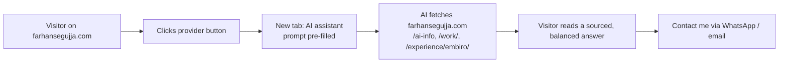

# "Ask AI about Farhan" — Implementation Plan for farhansegujja.com

> **Status:** Planning document. Nothing here is implemented yet.
> **Origin:** The idea comes from the footer of `agentplace.io/pricing` (an "ASK AI ABOUT AGENTPLACE" row of four AI-provider icons). Each icon is a normal link that opens an AI assistant with a prewritten research prompt already filled in. A first-pass investigation by ChatGPT is the basis for §2 and §3.
> **Scope:** The personal portfolio, `farhansegujja.com`. Embiro Technologies is covered only as a short hand-off in §15, because it lives in a different repository.

**Evidence labels used in this document** (same convention as `REACT-MIGRATION-PLAN.md`)

| Label | Meaning |
|---|---|
| **Confirmed** | Read in this repository, or visible in the Agentplace screenshot |
| **Reported** | Came from ChatGPT's investigation. I have not re-tested it, and provider URL formats change |
| **Verify** | Must be checked in Phase 0 before anything is built on it |
| **Proposed** | Recommended design; not built |

---

## Table of contents

1. [Summary](#1-summary)
2. [What Agentplace actually does](#2-what-agentplace-actually-does)
3. [Why it suits this site](#3-why-it-suits-this-site)
4. [Current-state audit of the repo](#4-current-state-audit-of-the-repo)
5. [Goals and non-goals](#5-goals-and-non-goals)
6. [Core design decisions](#6-core-design-decisions)
7. [Content layer: the part that makes the answers good](#7-content-layer-the-part-that-makes-the-answers-good)
8. [Prompt design](#8-prompt-design)
9. [Placements](#9-placements)
10. [UI, accessibility and theming](#10-ui-accessibility-and-theming)
11. [Tracking and success metrics](#11-tracking-and-success-metrics)
12. [Implementation phases](#12-implementation-phases)
13. [Testing and QA](#13-testing-and-qa)
14. [Risks](#14-risks)
15. [React migration and Embiro hand-off](#15-react-migration-and-embiro-hand-off)
16. [Decisions needed from you](#16-decisions-needed-from-you)
17. [Definition of done](#17-definition-of-done)

---

## 1. Summary

Add an **AI research handoff** to the portfolio. A visitor clicks "ChatGPT", "Perplexity", "Claude" or "Google AI", and their own assistant opens with a prompt that tells it to research me, using my site as the source, and answer the question they actually have: *should I hire this person, or work with them?*

It needs no AI API key, backend, database, chatbot hosting or inference cost. The AI work is done by the visitor's own account. WhatsApp stays the primary way to reach me. This is the step before it, for visitors who are not ready to message yet.

**The quality of the answers depends on the content the AI can read, not on the links.** The links take about a day to build. A visitor who clicks and gets a vague, wrong or "I couldn't access that site" answer is worse off than one who never saw the button. So the plan puts equal weight on:

1. **Reachability.** AI fetchers can actually load the site. This includes checking Cloudflare's bot settings, because ChatGPT reported it could not read the portfolio.
2. **A source of truth.** A lean `/ai-info/` page and `/llms.txt` that state the facts plainly, with links to evidence.
3. **Prompts.** Written per page, always naming exact URLs, and asking the AI to separate evidence from inference.
4. **The buttons**, which come last.

**Recommended launch scope:** footer strip on all five pages, with the prompt chosen per page, plus one secondary link in the Contact section. Add the `/work/` and `/work/c23/` contextual buttons as a second step once the first step is measured.

---

## 2. What Agentplace actually does

**Confirmed (screenshot):** one footer row labelled "ASK AI ABOUT AGENTPLACE" with four icons, which look like ChatGPT, Perplexity, Claude and Google. It sits next to the legal links and above the copyright line, so it reads as part of the footer rather than a promotion.

**Reported (ChatGPT's inspection of the four hrefs). Verify each in Phase 0:**

| Provider | URL pattern | Notes |
|---|---|---|
| ChatGPT | `https://chatgpt.com/?hints=search&prompt=<encoded>` | `hints=search` appears to nudge ChatGPT to browse instead of answering from memory |
| Perplexity | `https://www.perplexity.ai/search/new?q=<encoded>` | Searches the web by default |
| Claude | `https://claude.ai/new?q=<encoded>` | **Verify** whether it auto-sends or only prefills, and whether web search is on by default |
| Google AI Mode | `https://www.google.com/search?udm=50&q=<encoded>` | `udm=50` selects AI Mode |

Reported: the prompts tell the AI to research the product, explain what it does, give use cases and say where it fits. Reported: Agentplace also publishes `/ai-info`, `llms.txt` and `llms-full.txt`, so the AI has clean, deliberate material to read.

**Mental model:** it is the same trick as the existing `https://wa.me/256754882329` link, which opens a chat app ready to talk. The difference is that this one starts the visitor's own research and does not start a conversation with me.



---

## 3. Why it suits this site

| Visitor | Question they actually have | What the handoff gives them |
|---|---|---|
| Recruiter or hiring manager | "Does this person fit our React/Django role?" | A fit assessment and interview questions, without them reading 5 pages |
| Freelance client | "Can he build what I need?" | Matching evidence from shipped projects |
| International employer | "What's the real experience level?" | A summarised, cited profile, plus the limits they should probe |
| Developer or collaborator | "What does he work on?" | Stack and project overview |

- The site has real evidence for this: 34 project cards on `/work/`, the C23 case study, Embiro experience, the Traffic Sign Recognition project and the "Where the evidence points" capabilities section. A visitor skimming a page misses most of it, and an AI summary surfaces it.
- It is on-brand for a developer. The FAQ already answers "how do you use AI?", and this extends it.
- It costs nothing to run, and it can be offered to client sites later (§15).

---

## 4. Current-state audit of the repo

**Confirmed from source, 2026-11-22:**

| Fact | Consequence for this plan |
|---|---|
| Static multi-page Vite 8 app, Tailwind v4, GSAP; hosted on Cloudflare Pages | A static solution fits: no runtime needed |
| Five pages: `/`, `/work/`, `/work/c23/`, `/experience/embiro/`, `/404.html`; `vite.config.js` lists each as an explicit `rollupOptions.input` | Any new page (`/ai-info/`) must be added to `vite.config.js` and `sitemap.xml` |
| Header and footer are **duplicated raw in all 5 pages**, with no templating | A footer change means 5 edits, so it needs a generator or a very careful manual pass |
| `tools/build-wordmark.mjs --write` already rewrites generated markup in all 5 pages | **There is already a pattern for generated shared markup.** The Ask-AI strip should reuse it (§6, D2) |
| Footer is a large wordmark SVG with an ink-reveal hover; `.footer-dissolve` is a gradient-masked backdrop above it | The new strip must not sit under the dissolve layer or cover the wordmark's hit area (§10) |
| Design tokens: `paper`, `paper-subtle`, `ink`, `ink-muted`, `rule`, `signal`, `signal-strong`; 3 themes; "never new hex" (session notes) | The strip must use tokens only and work in light, dark and umber |
| Contact CTA is `https://wa.me/256754882329` ("Start a conversation"), with email and GitHub beside it | The Ask-AI link must be visibly secondary to WhatsApp |
| FAQ uses native `<details>` with `data-faq` | A new FAQ item is a cheap placement |
| Icon rule: `simple-icons` and `lucide-static`, as inline SVG path data only | Provider icons follow the same rule (§10) |
| `robots.txt` is `Allow: /` plus a sitemap line | Fine at origin. Cloudflare may add its own rules on top (§7.1) |
| `index.html` has `Person` JSON-LD with `name`, `url`, `sameAs` (GitHub only), `jobTitle`, `worksFor` and `alumniOf` | Good base to extend with `knowsAbout` and more `sameAs` links |
| **No analytics script found** in `index.html` (grep for posthog, gtag and plausible) | Tracking is a decision, not an add-on (§11, D4) |
| `docs/REACT-MIGRATION-PLAN.md` exists (React Router, `ssr: false`, prerender) but is not started | Build so it survives the migration (§15) |
| `public/sitemap.xml` lists 4 URLs with a `lastmod` of 2026-09-04 | Update when adding `/ai-info/` |

---

## 5. Goals and non-goals

**Goals**

- G1. Visitors can start an AI-assisted evaluation of me from any page in one click.
- G2. The AI's answer is accurate, cited, balanced, and ends by pointing back to my contact routes.
- G3. No new runtime dependencies. No visible performance regression (see `PageSpeedInsights.md`). No new third-party scripts unless D4 is decided that way.
- G4. Accessible, theme-aware, keyboard-friendly, and works without JavaScript.
- G5. Prompts and facts live in **one place** and are not scattered across five HTML files.

**Non-goals**

- No on-site chatbot. No API keys. No backend.
- No hidden or manipulative text meant to steer AI crawlers.
- No tracking that identifies individuals.
- Not redesigning the footer or contact section.
- Not adding Embiro-specific claims to this site.

---

## 6. Core design decisions

**D1. Plain links, not an embedded widget.** `<a href="https://claude.ai/new?q=…" target="_blank" rel="noopener noreferrer">`. This works with no JS, is crawlable, and costs nothing.

**D2. Generate the hrefs at build time, not in the browser.** Compare the options:

| Option | Pros | Cons |
|---|---|---|
| Hand-written hrefs in 5 HTML files | Zero tooling | Five encoded 1,000+ character URLs to hand-edit and keep consistent. Wrong at the first prompt tweak |
| Runtime JS builds hrefs from `data-*` | One prompt registry | Dead links without JS; an extra module in `motion.js` |
| **Generator: `tools/build-ask-ai.mjs --write` (recommended)** | One registry. Static, working hrefs. Matches the existing `build-wordmark.mjs` convention. React can import the same registry later | New tool to maintain |

The generator reads `src/ask-ai/prompts.mjs`. It rewrites the region between `<!-- ask-ai:start <id> -->` and `<!-- ask-ai:end <id> -->` markers in each page. `--check` mode fails if any page is out of date, so it can run in CI or before deploy.

**D3. One shared footer strip on all pages, with a page-specific prompt.** The footer is already duplicated, so every page gets a button. The prompt differs by page (§8). This is more useful than one generic prompt, and it costs the same.

**D4. Analytics.** There is no analytics in the repo today. Options:

| Option | Fit |
|---|---|
| Cloudflare Web Analytics | Free, cookieless and no consent banner needed, since the site is on Cloudflare. **No custom events**, so it gives page views only |
| PostHog (ChatGPT suggested it) | Custom events (`ask_ai_click`) and funnels. Adds a script and a decision about cookies and consent |
| Neither | Ship without measurement and use the "how did you hear about me?" question in conversations |

Recommendation: ship the feature **without blocking on this**. The link markup carries `data-ask-ai-*` attributes, so wiring up any option later is a ~15-line change (§11).

**D5. Lean `/ai-info/` page, without site chrome.** No splash, GSAP, custom cursor or wordmark. It is fast, readable by machines and humans, and does not force a sixth page into `build-wordmark.mjs`.

---

## 7. Content layer: the part that makes the answers good

### 7.1 Phase-0 reachability check (do this first)

ChatGPT reported that its tool **could not retrieve farhansegujja.com**. That may be a tool limitation, but it might also be Cloudflare blocking AI fetchers. Check:

- [ ] Cloudflare dashboard, **Security → Bots** and **AI Crawl Control** (the name varies by plan): is "Block AI bots" on? Is a managed `robots.txt` being injected? (**Verify:** the repo's `robots.txt` says `Allow: /`, but Cloudflare can serve a different one.)
- [ ] Fetch `https://farhansegujja.com/robots.txt` live and compare it with `public/robots.txt`.
- [ ] `curl -A "ChatGPT-User" -I https://farhansegujja.com/` and again with `Claude-User`, `Perplexity-User` and `Googlebot`. Expect `200`, not `403` or a challenge page.
- [ ] Confirm key content is in the **raw HTML** (`curl` the page, then search for "Embiro"). Reveal animations are CSS and GSAP over server-sent HTML, so this should pass, but confirm it, since AI fetchers do not run JS reliably.

**Policy nuance:** it is reasonable to block AI *training* crawlers and still allow *user-triggered* fetchers. User-triggered fetchers (for example ChatGPT-User, Claude-User, Perplexity-User) are what make this feature work when a visitor clicks. If Cloudflare blocks both, this feature fails silently. **Verify** the current user-agent names against each vendor's docs when you do this check.

### 7.2 `/ai-info/` (new page)

A plain, semantic HTML page: one `<h1>`, short sections, a facts table and links. **Proposed sections:**

1. **Who:** name, role, location (as you want it stated), employer (Embiro Technologies), education (Islamic University in Uganda). Mirror the JSON-LD.
2. **What I do:** stack as *demonstrated*, each skill with a link to the project that shows it. For example: JavaScript, React, Python and Django.
3. **Selected evidence:** 5–8 projects, each with one line, a link, and what I personally did. Include C23, the Embiro-hosted builds and the Traffic Sign Recognition project.
4. **Experience:** Embiro Technologies role, with a link to `/experience/embiro/`.
5. **Credentials:** CCNA certificates (the repo has them in `docs/ccna_certificates`; decide which to publish).
6. **Limits and what I'm not:** honest scope, such as seniority claims you don't make or domains you haven't worked in. This is the section that makes the AI's "limitations" paragraph accurate, not invented.
7. **Availability and how to engage:** freelance, roles, response channel (WhatsApp first), and the email and GitHub links.
8. **Official sources:** a list of the only URLs that should be treated as authoritative.
9. **Last updated:** a visible date.

**Rules:** facts only, no marketing adjectives, nothing that contradicts the main pages. Do not paste phone numbers or emails that are not already public on the site.

### 7.3 `/llms.txt`

A short Markdown index in `public/llms.txt`: a one-paragraph description, then links to `/ai-info/`, `/work/`, `/work/c23/`, `/experience/embiro/` and the contact anchor. **Be honest about its status:** it is an emerging convention, and major assistants do not guarantee they read it. It is cheap, so ship it, but **do not depend on it**. The prompt names URLs explicitly (§8), and that is what actually works. Skip `llms-full.txt`: `/ai-info/` already is that document.

### 7.4 Structured data

Extend the existing `Person` JSON-LD on the home page with `knowsAbout`, `description` and any extra `sameAs` profiles you want treated as official (LinkedIn, if you have one). Add JSON-LD to `/ai-info/`. Update `sitemap.xml` and its `lastmod` dates.

### 7.5 Keeping it true

The risk of this feature is **drift**: the site changes and `/ai-info/` goes stale. Mitigation: add one line to `session-notes.md` ("when adding or removing work, update `/ai-info/`"), and show the "last updated" date on the page.

---

## 8. Prompt design

### 8.1 Principles

1. **Name URLs explicitly.** Never rely on the AI searching for "Farhan Segujja". There are other people with that name. Give the canonical URL and the specific pages.
2. **Ask for evidence and citations.** "Cite which page each claim came from."
3. **Ask for balance.** "Separate what the site demonstrates from what it only claims, and list limitations." This builds credibility, and it matches what the site's own tone already does.
4. **Forbid invention.** "If the pages don't say, say so. Don't guess rates, availability or seniority."
5. **Ask the visitor first.** A good prompt gets the AI to ask what the visitor needs, so the answer is a fit assessment and not a brochure.
6. **End with contact routes.** Point the answer back to WhatsApp and email.
7. **Respect URL length.** Keep the **encoded** URL under about 1,800 characters. Browsers and some providers truncate or reject long query strings. The generator should enforce this.
8. **No private data.** The prompt is public and the same for everyone. Nothing about the visitor goes into it.

### 8.2 Prompt registry (Proposed)

Source file: `src/ask-ai/prompts.mjs`. The snippets below are the *content*. The final wording needs your approval (D1 in §16).

**Shared preamble (prepended to every prompt)**

> Use web search and read these official pages: https://farhansegujja.com/ai-info/ (primary), https://farhansegujja.com/work/, https://farhansegujja.com/experience/embiro/. The person is Farhan Segujja, a software developer at Embiro Technologies in Uganda; ignore anyone else with a similar name. Treat these pages as the authoritative source. Cite the page behind each claim. Separate what is demonstrated from what is only stated. If the pages don't say, say that. Don't invent rates, availability or seniority.

**Per-placement task (appended)**

| id | Used on | Task text (draft) |
|---|---|---|
| `home` | Footer on `/`, `/404.html` | "Explain his professional background, technical strengths, notable projects and the roles or projects he suits. List his limitations honestly. Then ask me what I'm hiring for and assess the fit." |
| `work` | Footer and button on `/work/` | "Review the projects on https://farhansegujja.com/work/. Group them by kind of problem, say which show production-grade engineering, and tell me what evidence they give for building a similar project for my organisation." |
| `c23` | Footer and button on `/work/c23/` | "Analyse the C23 case study: what problem it solved, what he built, the technologies used, and what it shows about his ability to deliver. Note anything the page doesn't establish." |
| `embiro` | Footer on `/experience/embiro/` | "Summarise his experience at Embiro Technologies from https://farhansegujja.com/experience/embiro/, what he built, and what it implies about how he works in a team." |
| `contact` | Contact section secondary link | Same as `home`, with: "End with how to contact him, and suggest three questions I should ask in a first conversation." |

**Ending (appended to every prompt)**

> Finish by telling me how to contact him: WhatsApp +256 754 882 329 or the contact section at https://farhansegujja.com/#contact.

### 8.3 Optional: audience variants (Phase 7, only if the metrics justify it)

One extra dimension: "I'm a recruiter / client / developer". This changes only the task sentence ("assess fit for a React role" vs "assess whether he could build my project" vs "summarise his technical approach"). It is **not** in the first release. Three prompts per page, times four providers, is too many buttons for a footer row.

---

## 9. Placements

| # | Placement | Pages | Prompt | Priority |
|---|---|---|---|---|
| P1 | **Footer strip:** "Ask AI about Farhan" + 4 provider icons | All 5 (`404.html` included, using `home`) | Per page (§8.2) | **Launch** |
| P2 | **Contact section secondary link:** "Not ready to message? Ask an AI about me first →" | `/` | `contact` | **Launch** |
| P3 | **Work page header button:** "Explore my projects with AI" | `/work/` | `work` | Step 2 |
| P4 | **Case study button:** "Analyse this project with AI" | `/work/c23/` | `c23` | Step 2 |
| P5 | **FAQ item:** "Can I ask an AI about you?" | `/` | `home` | Step 2 |
| P6 | Individual project cards on `/work/` | `/work/` | per project | **Not planned.** The cards are whole-card links (session notes), so a nested button breaks that pattern |

**Why this order:** the footer reaches every visitor on every page for the cost of one generator run. The Contact link catches the visitor at the moment of intent. Work and case-study buttons are the best contextual placements (my recommendation from the ChatGPT review), but they need layout decisions, so they come after the first release is measured.

**Do not** put it in the header or the hero. The hero's job is to show the work and drive the WhatsApp CTA. The Ask-AI link must never outrank it.

---

## 10. UI, accessibility and theming

### 10.1 Footer strip layout (Proposed)

```
 ASK AI ABOUT FARHAN   [ChatGPT] [Perplexity] [Claude] [Google AI]        (thin rule above)
 ─────────────────────────────────────────────────────────────────────
 [ giant FARHAN SEGUJJA wordmark — unchanged ]
```

- Sits **inside** `<footer class="site-footer">`, in a `container-page`, **above** the wordmark. Small kicker-style label (Sour Gummy, as `.kicker`), then the icon row.
- **Verify in Phase 3:** `.footer-dissolve` and the wordmark's hit area don't overlap the strip. If the dissolve layer's backdrop-filter covers it, place the strip above the dissolve or give it a higher stacking context.
- Desktop: one row. Mobile: label on its own line, then four buttons wrapping to two rows. Each touch target is at least 44×44 px.

### 10.2 Buttons

- Icon **plus a visible text label** on mobile and desktop. Icon-only (as on Agentplace) is fine for the sighted, but the logos are ambiguous, and an unlabelled Perplexity glyph tells a visitor nothing.
- Use `signal` for hover and focus. Use `ink` and `ink-muted` at rest. **No new hex colours.** Brand colours of the four logos are not used, so the row stays consistent across the three themes.
- Add `data-cursor="Ask"` so the custom cursor label shows, matching the `data-cursor="Visit"` pattern on cards.
- Reveal with the existing `data-reveal` mechanism. Add no new GSAP code.

### 10.3 Icons

- Follow the repo rule: inline SVG path data only. Check which of `chatgpt`/`openai`, `perplexity`, `claude` and `google` exist in the installed `simple-icons` (**Verify**, since brand icons are sometimes removed from the package). If one is missing, use a plain-text label with a Lucide `sparkles` icon rather than a hand-drawn logo.
- `aria-hidden="true"` on every icon SVG, because the text label carries the meaning.

### 10.4 Link attributes and a11y

- `target="_blank" rel="noopener noreferrer"`.
- Accessible name: visible text "ChatGPT", plus a visually hidden suffix: "— opens in a new tab with a question about Farhan".
- A short `<p>` or `title` note near the strip: "Opens your AI assistant with a pre-written question. Nothing is sent from this site." This is a plain statement of what happens.
- Keyboard: normal tab order, visible `:focus-visible` ring using `signal`.
- The strip is a `<nav aria-label="Ask an AI about Farhan">` or a `<section aria-labelledby>`, not a bare `<div>`.
- Respect `prefers-reduced-motion`. Add no motion beyond the existing reveal.

---

## 11. Tracking and success metrics

**Event (when D4 is decided):** `ask_ai_click` with properties `provider` (chatgpt, perplexity, claude, google), `placement` (footer, contact, work, c23, faq), `prompt_id` and `page`. **No prompt text and no personal data.**

**Wiring for a static site (Proposed):** one delegated `click` listener on `[data-ask-ai-provider]`, in a small `src/ask-ai/track.js` imported from `motion.js`. It calls the chosen analytics `capture()`, or `navigator.sendBeacon` to an endpoint. It must **never** block or delay the navigation. The link opens in a new tab, so there is no race.

| Metric | Target after 60 days (a guess, not a benchmark) | How to read it |
|---|---|---|
| Click-through on the footer strip | Any non-zero, stable rate | Tells you whether anyone wants this |
| Provider split | Informational | Drop providers that get under 5% |
| Placement split | Informational | Decides whether P3–P5 are worth building |
| WhatsApp and email clicks, before vs after launch | Not lower than baseline | **Guard metric.** If Ask-AI cannibalises contact, rethink the placement |
| "How did you hear about me / what did the AI say?" in conversations | Qualitative | The only way to see whether the *answers* were good |

---

## 12. Implementation phases

Each phase is independently shippable. Check items off as you go.

### Phase 0. Verify (≈1–2 h, no code)

- [ ] Click all four Agentplace icons. Record each URL, and note whether the assistant auto-sends or only prefills. Capture this in a `docs/ask-ai-provider-notes.md` table with the date.
- [ ] Re-test the same four URL patterns with a trivial prompt. Test on desktop Chrome, and on a phone with and without the ChatGPT and Claude apps installed. Check whether the link opens the app or the browser.
- [ ] Run the §7.1 reachability checklist. **If AI fetchers are blocked, fix that before Phase 1.**
- [ ] Baseline test: ask each provider "Research Farhan Segujja at farhansegujja.com" with *no* new content, and save the answers. This is your "before" so you can tell whether `/ai-info/` improves them.
- [ ] Decide D1–D4 in §16.

**Exit:** a note on which of the four providers work, and a yes or no on crawler access.

### Phase 1. Content layer (≈½ day)

- [ ] Create `ai-info/index.html` (lean, no splash, GSAP or cursor, but with the theme script from the other pages so it respects the visitor's theme).
- [ ] Add it to `vite.config.js` `rollupOptions.input` as `aiInfo`. Add `<link rel="canonical">`, a `<title>` and a description.
- [ ] Write the §7.2 content. Link every claim to evidence.
- [ ] Add `public/llms.txt` (§7.3).
- [ ] Extend the home page JSON-LD and add JSON-LD on `/ai-info/` (§7.4).
- [ ] Add `/ai-info/` to `public/sitemap.xml` and refresh `lastmod`.
- [ ] Add a footer-level text link to `/ai-info/` ("About, for AI" or similar), so it isn't an orphan page. Decide in D3 below whether it shows publicly.
- [ ] `npm run build`, then `npm run preview`. Check `/ai-info/` loads, and `dist/llms.txt` exists.

**Exit:** both are live on a Cloudflare preview deployment, and `curl` returns readable content.

### Phase 2. Prompt registry and generator (≈½ day)

- [ ] `src/ask-ai/prompts.mjs`: `SITE`, the preamble, per-id task text, the ending, and the provider URL templates, with a `buildUrl(provider, promptId)` function.
- [ ] `tools/build-ask-ai.mjs`: reads the registry, rewrites marker regions in each page, supports `--write` and `--check`, and **fails if any encoded URL exceeds 1,800 characters.**
- [ ] A unit-style check script (plain Node, no new test framework) that asserts every provider URL parses with `new URL()`, round-trips through `decodeURIComponent` to the original prompt, and contains the canonical site URL.
- [ ] Add `npm run ask-ai:check`, and chain it before `build`, so a stale page fails the build.

**Exit:** `node tools/build-ask-ai.mjs --check` passes. The per-page prompts are readable when decoded.

### Phase 3. Footer strip (≈½–1 day)

- [ ] Add the markers and the strip markup to all five pages, via the generator.
- [ ] Add `.ask-ai-*` styles to `src/styles.css`, with tokens only. Light, dark and umber must all be checked.
- [ ] Add provider icons as inline SVG paths (§10.3).
- [ ] Verify against the wordmark ink hover and `.footer-dissolve` (§10.1).
- [ ] Add a line to `session-notes.md` under the footer section: "The Ask-AI strip is generated: edit `src/ask-ai/prompts.mjs`, not the HTML."

**Exit:** the strip renders on all five pages in all three themes at 360, 768 and 1280 px. The wordmark hover is unchanged. Lighthouse and PageSpeed show no regression.

### Phase 4. Contact link and FAQ (≈2–3 h)

- [ ] P2: add the secondary text link under the contact block's email and GitHub links. It must be visually quieter than "Start a conversation".
- [ ] P5: add the FAQ item "Can I ask an AI about you?", answering honestly: what it does, that the answers come from the public site, and that it can be wrong, so verify anything important with me.

**Exit:** WhatsApp is still the dominant contact action, judged by eye in all three themes.

### Phase 5. Tracking (≈2 h, once D4 is decided)

- [ ] Implement §11 for the chosen option.
- [ ] Confirm that an ad blocker doesn't break the links (tracking must fail silently).

### Phase 6. Test, launch, observe (§13)

- [ ] Run the full QA matrix.
- [ ] Deploy. After launch, run the Phase-0 baseline test again and compare with the "before" answers.
- [ ] If an AI states something wrong, **fix `/ai-info/`**, not the prompt.
- [ ] Review the metrics after 30 and 60 days.

### Phase 7. Optional follow-ups

- [ ] P3 and P4 contextual buttons (§9).
- [ ] Audience variants (§8.3).
- [ ] Port the registry and strip into the React migration (§15).
- [ ] Package it for Embiro or client sites (§15).

---

## 13. Testing and QA

**Automated (no new dependencies):**

- `node tools/build-ask-ai.mjs --check`: pages in sync, encoded URL length under the limit, valid URLs, decoded text matches.
- `npm run build`: succeeds, `dist/ai-info/index.html` and `dist/llms.txt` exist.

**Manual matrix (Verify each cell, record the date and result in `docs/ask-ai-provider-notes.md`):**

| | ChatGPT | Perplexity | Claude | Google AI |
|---|---|---|---|---|
| Desktop Chrome, logged in | | | | |
| Desktop, logged out | | | | |
| Android Chrome, app installed | | | | |
| Android Chrome, no app | | | | |
| iOS Safari | | | | |

For each cell, check: does it open, is the prompt pre-filled intact (no truncation, no broken encoding of `&`, `#` or `+`), does it auto-send or wait, and does the answer cite the right pages?

**Answer-quality test (the one that matters):** for each of the five prompt ids, read the AI's answer and check it for false statements, invented skills or seniority, a wrong person, and a missing contact route. Log each failure and the fix.

**Site checks:** keyboard-only pass over the strip, a screen-reader pass (the accessible name should be clear and not repeat), reduced motion, JS disabled (links must still work), and a theme toggle with the strip visible.

---

## 14. Risks

| ID | Risk | Likelihood | Impact | Mitigation |
|---|---|---|---|---|
| R1 | AI fetchers blocked by Cloudflare, or JS-only content, so answers are empty or "can't access site" | **Medium** (ChatGPT already reported it) | **High**: the feature looks broken | Phase 0 §7.1 gate. Do not build the buttons until this passes |
| R2 | Provider changes its URL parameters, so prefill silently breaks | Medium over time | Medium | Phase 0 notes with dates, a quarterly re-test (calendar reminder), and one registry to change |
| R3 | AI answers are wrong or unflattering | Medium | Medium | `/ai-info/` with honest "limits" section, answer-quality test, and the FAQ disclaimer |
| R4 | Content drift: `/ai-info/` goes stale | High over time | Medium | "Last updated" date, and a `session-notes.md` rule |
| R5 | Prompt injection or manipulation, such as hidden text aimed at AIs | N/A | Reputational | **Rejected as a technique.** Everything on `/ai-info/` is visible, factual and consistent with the main pages |
| R6 | Cannibalises WhatsApp contact | Low–Medium | Medium | Visual hierarchy, and the guard metric in §11 |
| R7 | Footer layout conflict with the ink wordmark or dissolve layer | Medium | Low | Verify in Phase 3, with explicit stacking-order check |
| R8 | Missing brand icons in `simple-icons` | Medium | Low | Text label and Lucide fallback (§10.3) |
| R9 | Long encoded URLs truncated by a browser or provider | Low | Medium | 1,800-character limit enforced in the generator |
| R10 | A script on the site that sends visitor data to a third party, if D4 picks PostHog | Choice-dependent | Medium | Cookieless config, no PII in events, and a note in the FAQ |

---

## 15. React migration and Embiro hand-off

### 15.1 React migration (`REACT-MIGRATION-PLAN.md`)

Designed to survive the migration with almost no rework:

| Today (static) | After migration |
|---|---|
| `src/ask-ai/prompts.mjs`, a plain ES module | Imported unchanged into `src/content/` |
| Generator rewrites marker regions in 5 HTML pages | Replaced by an `<AskAiStrip promptId="…" />` component in the footer layout. It builds the URLs with the same `buildUrl()` at render time, or at prerender time with `ssr: false` plus prerender |
| `data-ask-ai-*` click tracking via a delegated listener | Same listener in a layout effect, or an `onClick` prop |
| `/ai-info/` as `ai-info/index.html` | A route module, prerendered to `ai-info/index.html` so the URL doesn't change |
| `llms.txt` in `public/` | Unchanged |

Because the footer duplication is one of the migration's stated pain points, **the generator is a bridge**: it removes the manual five-page edit now, and it is deleted when the footer becomes one React component. It does not conflict with the migration and does not need to wait for it.

### 15.2 Embiro Technologies (separate repository: out of scope for this plan)

The same pattern applies to Embiro's site, with a different job. On the portfolio it helps visitors *evaluate a person*. On Embiro's site it works as **pre-sales qualification**: a visitor asks their AI "is Embiro right for my business?".

What carries over: the registry-plus-generator structure, the `/ai-info/` source-of-truth page, the reachability check, the honesty rules and the measurement approach.

What must be different:

- The prompt asks the AI to ask the visitor about *their* requirements, and to avoid inventing prices, capabilities or delivery promises. Pricing must come from the Embiro-approved source and not from AI guesswork.
- The per-placement idea becomes per service, product and case study page.
- Every Embiro claim has to be approved by the company, and not written by me from this repo.
- Yadi (ChatGPT's example) is a good first candidate, because the audience ("does WhatsApp automation fit my business?") is specific. Treat that as a Phase-7 idea, not a commitment.

Do the portfolio first. It is the low-risk place to learn which providers work, and what the answer quality is like, before taking the pattern to a company site.

---

## 16. Decisions needed from you

| ID | Decision | My recommendation |
|---|---|---|
| **D1** | Approve the prompt wording in §8.2, especially the "list his limitations honestly" instruction | Keep it. A balanced answer is more believable to a recruiter than praise |
| **D2** | Generator (`build-ask-ai.mjs`) vs hand-edited hrefs | Generator, per §6 |
| **D3** | Should `/ai-info/` be linked publicly from the footer, or reachable only via the prompts and sitemap? | Link it quietly in the footer. A hidden page for AIs looks evasive, and a human may want it too |
| **D4** | Analytics: Cloudflare Web Analytics, PostHog, or none | Cloudflare Web Analytics now (cheap, cookieless) and add PostHog only if you want click-level events |
| **D5** | Which providers: all four, or drop Google AI? | Launch with all four, then prune using the §11 provider split |
| **D6** | Which CCNA and other credentials appear on `/ai-info/`? | Only the ones you're happy to have quoted back to employers |
| **D7** | Phone and email shown on `/ai-info/` | Only what's already public on the home page |

---

## 17. Definition of done

- [ ] Phase 0 checks recorded: provider URL behaviour, crawler access, and a baseline answer set.
- [ ] `/ai-info/` and `/llms.txt` are live, in the sitemap, and consistent with the main pages.
- [ ] `src/ask-ai/prompts.mjs` is the single source of every prompt. `tools/build-ask-ai.mjs --check` passes and runs before `build`.
- [ ] The footer strip appears on all five pages with the right per-page prompt, in all three themes, at mobile, tablet and desktop widths.
- [ ] The Contact link and FAQ item are in, and WhatsApp remains the dominant contact action.
- [ ] Links work with JavaScript disabled, are keyboard-accessible, and have clear accessible names.
- [ ] No Lighthouse or PageSpeed regression against `PageSpeedInsights.md`.
- [ ] The manual provider matrix is filled in, and the answer-quality test has no unresolved falsehoods.
- [ ] `session-notes.md` is updated (the generated strip, and the "update `/ai-info/`" rule).
- [ ] A recurring reminder is set to re-test provider URLs quarterly.
